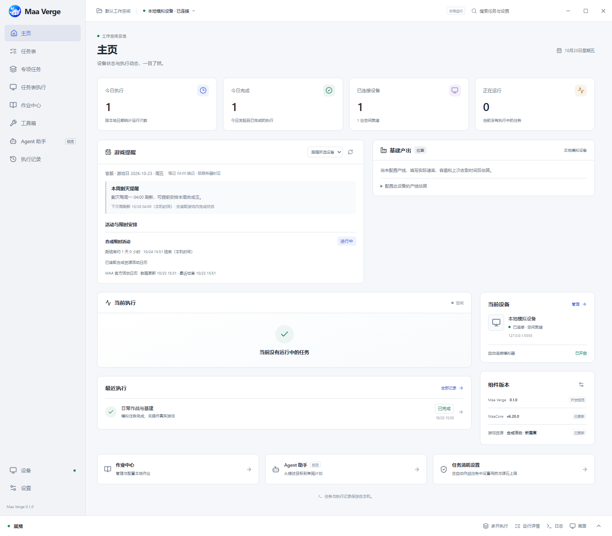
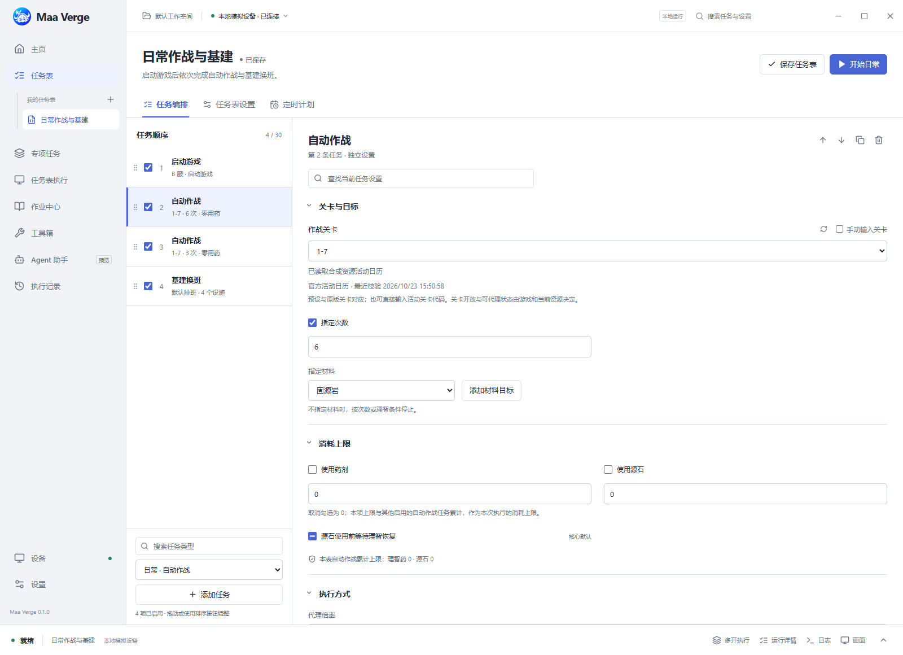
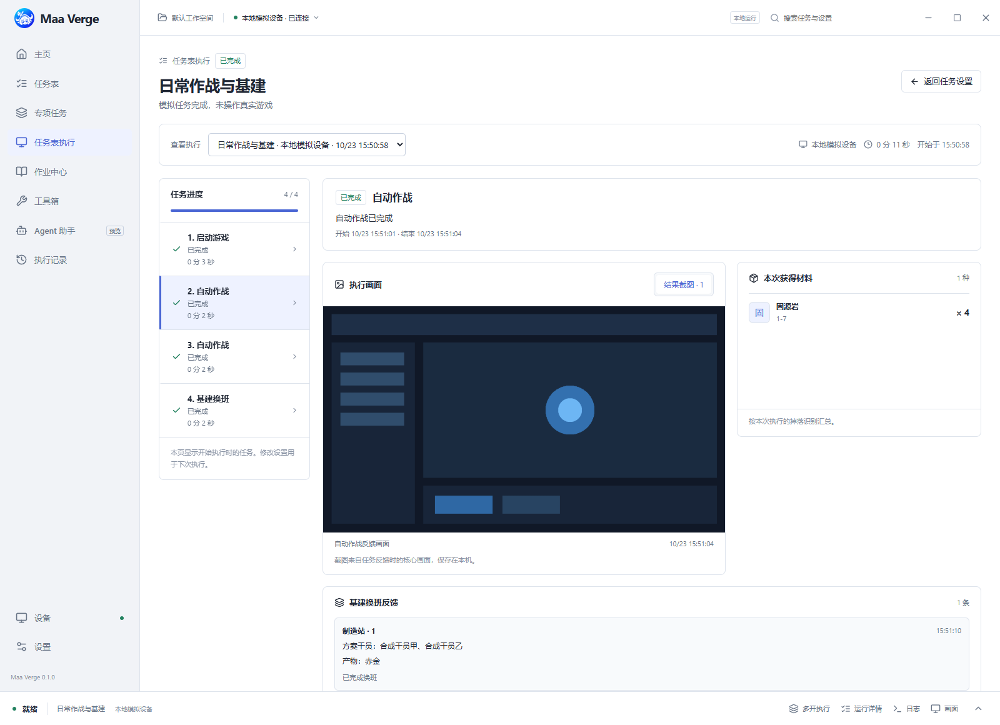
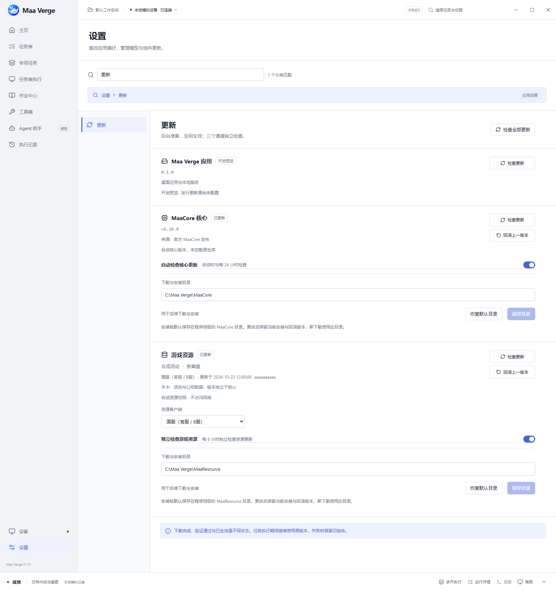

<p align="center">
  
</p>

# Maa Verge

基于 MaaCore 的本地明日方舟桌面助手，使用 Tauri 2、React/TypeScript、TypeScript 本地服务与 C++20 核心工作进程，目标平台为 Windows、macOS 和 Linux。界面与业务服务通过类型化 JSON-RPC 通信，原生核心与桌面进程隔离。

当前为 **0.1.0 开发预览**。请以 [开发状态](docs/STATUS.md) 判断当前实际能力；[完整计划](PLAN.md) 描述后续交付。开发和安装版均直接使用真实设备、核心、画面和更新源，仅 Agent 保留本地规则提案。自动测试使用隔离夹具。

[下载 v0.1.0 开发预览](https://github.com/DeathofBrain/maa-verge/releases/tag/v0.1.0) · [版本说明](docs/releases/v0.1.0.md)

默认进入主页仪表盘，任务表通过独立侧栏入口管理。Logo 采用蓝色渐变与帕拉斯白色头部图形，保留双角和玫瑰；[设计说明](docs/branding.md) 记录图标来源、提示词和生成方式。仓库：[DeathofBrain/maa-verge](https://github.com/DeathofBrain/maa-verge)。



## 当前功能

- **主页仪表盘**：今日执行、最近记录、连接设备与三条组件版本；从原 MAA 同一官方接口获取活动日历，显示剿灭日历提醒和按设备手工校准的基建产出估算。
- **任务表工作台**：新建日常表采用原版九项默认队列与常规参数，自动命名“日常表1”等；支持重复/复制/排序/启停、逐项设置、表级设备绑定；消耗上限由启用的自动作战任务中的用药与源石数量累计。作战关卡默认下拉，包含当期活动，可勾选手动输入；基建无人机用途使用下拉。
- **任务表执行页**：启动后集中展示逐项状态、材料累计、基建反馈、结果截图与只读实时画面，任务名称和常见执行提示显示中文；从主页和执行记录重新查看，新记录保留启动时的任务快照，较早记录可能没有逐项结果。
- **模拟器多开**：发现 Windows MuMu、雷电的已启动实例，默认按核实的实例与 SDK 自动配置增强截图，每实例独立保存 ADB、触控、截图和客户端设置；同一未绑定任务表可并行执行，分别查看进度、日志并停止。每设备独立工作进程与设备锁，客户端资源分别加载。
- **设备与更新**：Windows 可从运行进程定位模拟器内置 ADB，支持自定义安装盘；只有自动生成的实例清单时继续发现新实例，存在手动配置时限定到清单逐项连接。核心首次安装、核心更新和资源更新独立处理，验证后在任务空闲边界切换。核心和资源可分别设置下载与安装目录，安装版默认在程序同级；资源版本展示活动名称和更新时间，官服与 B 服共用国服资源，外服分别展示。
- **桌面界面**：一体化顶栏、窗口控制、浅色/深色/跟随系统、侧栏悬停反馈与平滑过渡，支持减少动态效果和窄窗导航。

当前 Agent 提供 mock 计划提案；真实模型、定时调度、库存保持、社区作业及专用识别结果尚未完整接入。完整原 MAA 兼容仍是交付目标，范围与缺口见 [功能覆盖与验收](docs/maa-compatibility.md)。平台验证以状态文档为准。

## 界面预览

以下截图均由当前界面和隔离测试夹具生成；设备、活动、材料与反馈画面为合成示例，不代表真实账号执行结果。

<details>
<summary>任务准备：逐项设置关卡、作战次数与消耗上限</summary>



</details>

<details open>
<summary>任务表执行：任务进度、反馈画面、材料汇总与基建结果</summary>



</details>

<details>
<summary>组件更新：独立下载目录、国服与外服活动版本</summary>



</details>

## 任务设置与多开

在「任务表」中新建日常表即可获得原版默认任务及参数，常规设置与执行映射见 [任务设置对照](docs/maa-task-settings.md)。旧任务表的任务与参数保留，消耗上限统一由已启用的自动作战任务累计。新任务默认不使用理智药或源石，直接在自动作战任务中设置数量，设置页不再另设授权预算；新建作战任务的企鹅物流/一图流汇报开关与原版一致，可在设置中关闭。公招加急目前禁用。

点击开始后进入「任务表执行」，可逐项查看本次任务、材料和基建反馈，返回设置时保留草稿。结果截图保存在本机，来自任务反馈后的核心缓存画面，可能已进入后续场景，不能保证是原始结算图。

在「设置 → 更新」分别配置 MaaCore 与游戏资源的下载/安装目录。安装版默认使用程序同级的 `MaaCore/`、`MaaResource/`，开发版使用各 checkout 的隔离数据目录。改路径仅影响后续下载，保留当前安装与回滚版本。官服与 B 服共用国服资源，外服显示各自活动版本；活动标签不代表活动仍开放。详见 [组件安装与更新](docs/maacore-runtime.md)。

使用多开时，先在模拟器管理器启动各实例并开启 ADB，再到「设备」页发现并连接。截图协议默认「自动识别（推荐）」：Windows MuMu、雷电在 SDK 和实例信息核实后自动保存对应目录、编号和独立配置；其他设备使用 ADB。也可显式选择 ADB 或手动增强截图，已选增强接口失败时会报错，不静默降级。连接后在底部「多开执行」选择任务表并开始。Maa Verge 当前管理已启动的实例，不自动创建或启停模拟器。详见 [多开说明](docs/multi-instance.md)与[共享连接设置](docs/connection-settings.md)。

活动日历支持官方主/备用源、条件请求、离线缓存和手动刷新；活动关卡还需当前核心与资源支持。剿灭提示仅按游戏日提醒，基建估算需要填写速率、容量和上次收取时间，均不代表已读取游戏内完成情况。详见 [游戏提醒](docs/game-reminders.md)。开发验证使用合成设备与浏览器夹具，真实连接与增强截图实测限本机 Windows 单个 MuMu；雷电、真实游戏多开、各客户端及 macOS/Linux 的新增行为仍需单独验收，具体记录见 [开发状态](docs/STATUS.md)。

## 安装与运行

从 [GitHub Releases](https://github.com/DeathofBrain/maa-verge/releases) 下载对应系统与架构的安装包：Windows x64 提供 EXE / MSI，macOS 提供 Apple Silicon / Intel DMG，Linux x64 提供 AppImage / DEB / RPM。macOS 最低目标为 13.5。当前开发预览包未完成正式签名和 macOS 公证。

用户无需安装 Python、Node 或 Bun；Windows 使用 WebView2，Linux 仍需系统 WebView 和桌面库。启动后按需下载 MaaCore 与资源，连接已启动的模拟器，再由用户手动开始任务。发行包的验证范围和已知限制见 [v0.1.0 版本说明](docs/releases/v0.1.0.md)。

## 开始开发

安装 Node（版本见 `.node-version`）和 `package.json` 指定的 pnpm，或使用仓库内引导脚本：

```powershell
# Windows PowerShell，跳过 Python 参考测试依赖
powershell -ExecutionPolicy Bypass -File tools/bootstrap.ps1 -SkipReference
powershell -ExecutionPolicy Bypass -File tools/pnpm.ps1 dev
```

```bash
# macOS / Linux
bash tools/bootstrap.sh --skip-reference
bash tools/pnpm.sh dev
```

不加 `-SkipReference` / `--skip-reference` 时还会准备 uv、Python 3.12 和锁定依赖，供保留的 Python 参考测试及 C++ 合成测试使用。首次运行 `pnpm dev` 会下载并校验 `.bun-version` 固定的 Bun 1.4.3，并构建 C++ worker。工具放入忽略的 `.tools` 目录，不改系统 PATH 或用户配置。上面的包装脚本可在没有全局 Node/pnpm 的终端使用；已有固定版本工具链时直接运行 `pnpm dev`。表中其他 pnpm 命令也可通过同一包装脚本执行。

原生开发还需 Rust、CMake 3.25+、C++20 编译器与对应系统 SDK，详见 [环境搭建](docs/development.md)。macOS 当前最低目标为 13.5。

| 命令 | 用途 |
| --- | --- |
| `pnpm dev` | React + Tauri + TypeScript 服务与 C++ worker，直接连接真实环境 |
| `pnpm dev:ui` | 仅启动前端开发服务器；普通浏览器无桌面服务时明确提示不可用 |
| `pnpm setup:bun` | 下载、SHA-256 校验并安装项目固定的 Bun |
| `pnpm run doctor` | 工具链、依赖和本地环境诊断 |
| `pnpm check` | 契约、TypeScript 后端、C++ 合成测试、Python 参考及可用时的 Rust 检查 |
| `pnpm test:runtime` | TypeScript 服务测试；构建原生合成库后还执行对应集成场景 |
| `pnpm test:packaging` | 编译并执行当前平台的 Bun 自包含发行探针 |
| `pnpm test:desktop-runtime` | 检查 Rust transport → 包内真实服务，以及合成设备键的 C++ 租约 |
| `pnpm test:e2e` | 通过测试目录内的 IPC 夹具验证界面流程 |
| `pnpm -r build` | 工作区类型检查与前端生产构建 |
| `pnpm build` | 当前系统与架构的桌面包、自包含 TypeScript 服务及 C++ worker |

发行包内嵌 Bun/JavaScriptCore，用户无需安装 Python、Node 或 Bun。它仍使用系统库及桌面 WebView；MaaCore 和资源按需下载安装。Python 仅保留为开发参考，显式 `MAAVERGE_BACKEND=python` 只在 debug 桌面构建生效，发行包不会回退到 Python。数据库交接、构建产物、第三方许可和 Bun/JSC 重建说明见 [运行时迁移交接](docs/runtime-migration.md)。

MaaCore 与游戏资源在候选目录准备，不覆盖正在使用的文件；核心版本不变时仍独立检测资源更新。自动连接行为与配置见 [连接说明](docs/emulator-connection.md)。修改 Logo 主资源后，运行 `node tools/generate-icons.mjs` 重新生成桌面图标。

启动模拟器后运行 `dev`，程序会发现并连接正在运行的实例，连接后由你手动启动任务。Windows 已识别的 MuMu、雷电安装布局可自动定位内置 ADB 与增强截图；未识别的布局可在设备页手动选择，或配置 `MAAVERGE_ADB_PATH` / `MAAVERGE_EMULATOR_DIRS`。原有 `MAAVERGE_MODE=mock` 已不支持，请删除该环境变量；旧 `mock` 数据目录保留但不再读取，真实数据继续使用 `native` 子目录。

## 协作与许可

跨电脑使用 Git 同步源码、文档和锁文件，在各机重新安装依赖。设备、数据库、缓存、密钥和虚拟环境不进入 Git。自动化贡献者先读 [AGENTS.md](AGENTS.md)，提交方式见 [CONTRIBUTING.md](CONTRIBUTING.md)。提交信息使用 Conventional Commits，冒号后的说明使用简体中文，例如 `feat: 添加主页仪表盘`。

Maa Verge 采用 **AGPL-3.0-only**。MAA/MaaCore 为 [MaaAssistantArknights](https://github.com/MaaAssistantArknights/MaaAssistantArknights) 上游项目；Maa Verge 使用独立名称，不代表游戏官方或上游官方客户端。
