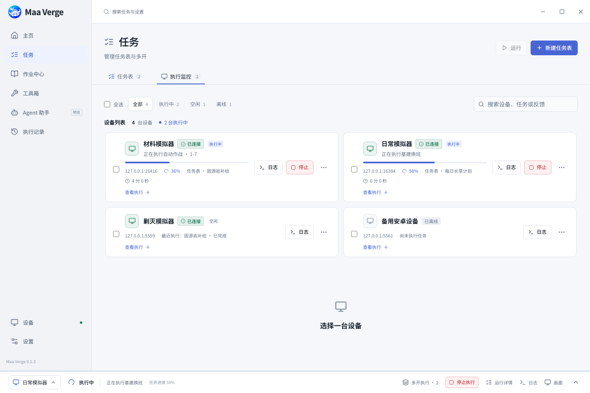

  

<h1 align="center">Maa Verge</h1>

真正的跨平台 · （未来）真正的PRTS（大嘘） · 正在努力开发中

  <a href="https://github.com/DeathofBrain/maa-verge/releases"><strong>下载软件</strong></a> ·
  <a href="#快速开始">快速开始</a> ·
  <a href="#常见问题">常见问题</a> ·
  <a href="https://github.com/DeathofBrain/maa-verge/issues">反馈问题</a>

Maa Verge 是一款免费开源的明日方舟桌面助手，基于 [MAA](https://github.com/MaaAssistantArknights/MaaAssistantArknights) 的自动化核心。你可以把基建、公招、自动作战等日常安排成任务表，连接模拟器后手动开始，并在软件中查看进度和执行记录。

> 当前提供 **[v0.1.2 正式版](https://github.com/DeathofBrain/maa-verge/releases/tag/v0.1.2)**，本页的安装与使用说明以该发行版为准。Agent 和部分上游功能仍在开发，完整更新与已知限制见 [版本说明](https://github.com/DeathofBrain/maa-verge/blob/v0.1.2/docs/releases/v0.1.2.md)。

> 也可体验 **[v0.1.3-alpha.1 预览版](https://github.com/DeathofBrain/maa-verge/releases/tag/v0.1.3-alpha.1)**，包含新的任务中心、设备监控、作业库和下载更新体验。预览版的安装包与界面有调整，升级前请阅读下方预览版说明及[完整版本说明](https://github.com/DeathofBrain/maa-verge/blob/v0.1.3-alpha.1/docs/releases/v0.1.3-alpha.1.md)。

## 下载与安装

从 **[GitHub Releases](https://github.com/DeathofBrain/maa-verge/releases)** 下载软件，也可以点击下表直接下载 v0.1.2 安装包。

本项目也已接入 [Mirror酱](https://mirrorchyan.com?source=maa_verge_readme)分发。**Mirror酱在用户端的高速下载是付费服务，需要有效 CDK**；Maa Verge 本身免费开源，GitHub 官方免费下载继续保留。当前开发源码新增的「设置 → 更新 → Mirror酱」共用 CDK 配置及 MaaCore / MaaResource 对应关系见[服务说明](docs/mirrorchyan.md)，这些新增设置尚未包含在上述已发布版本中。

v0.1.3-alpha.1 预览版最低支持 **macOS 15（Sequoia）**，适用于 Apple Silicon 和 Intel；当前源码及后续发行包按此要求构建。v0.1.2 正式版的历史构建目标仍为 macOS 13.5。

| 系统                                | 安装包                                                                                                                                                                                                                                                                                                                       | 安装方式                                                        |
| ----------------------------------- | ---------------------------------------------------------------------------------------------------------------------------------------------------------------------------------------------------------------------------------------------------------------------------------------------------------------------------- | --------------------------------------------------------------- |
| Windows x64                         | [EXE（推荐）](https://github.com/DeathofBrain/maa-verge/releases/download/v0.1.2/Maa-Verge_0.1.2_x64-setup.exe) / [MSI](https://github.com/DeathofBrain/maa-verge/releases/download/v0.1.2/Maa-Verge_0.1.2_x64_zh-CN.msi)                                                                                                    | 下载后运行安装程序                                              |
| macOS 15+ · Apple Silicon（M 系列） | [DMG · aarch64](https://github.com/DeathofBrain/maa-verge/releases/download/v0.1.2/Maa-Verge_0.1.2_aarch64.dmg)                                                                                                                                                                                                              | 打开后将应用拖入「应用程序」                                    |
| macOS 15+ · Intel                   | [DMG · x64](https://github.com/DeathofBrain/maa-verge/releases/download/v0.1.2/Maa-Verge_0.1.2_x64.dmg)                                                                                                                                                                                                                      | 打开后将应用拖入「应用程序」                                    |
| Linux x64                           | [AppImage](https://github.com/DeathofBrain/maa-verge/releases/download/v0.1.2/Maa-Verge_0.1.2_amd64.AppImage) / [DEB](https://github.com/DeathofBrain/maa-verge/releases/download/v0.1.2/Maa-Verge_0.1.2_amd64.deb) / [RPM](https://github.com/DeathofBrain/maa-verge/releases/download/v0.1.2/Maa-Verge-0.1.2-1.x86_64.rpm) | AppImage 赋予执行权限后运行；DEB / RPM 使用系统软件包管理器安装 |

在 Release 页面下载时，安装包位于 **Assets** 中。**Source code** 是源码压缩包，普通使用无需下载；[SHA256SUMS.txt](https://github.com/DeathofBrain/maa-verge/releases/download/v0.1.2/SHA256SUMS.txt) 可用于核对下载文件。

安装前请准备好：

- **模拟器与游戏**：自行安装安卓模拟器和明日方舟，在模拟器设置中开启 ADB 调试。
- **网络连接**：首次运行需要下载 MaaCore 和游戏资源，软件会自动准备，无需手动安装核心，也无需安装 Python、Node.js 或 Bun。
- **系统组件**：Windows 使用 WebView2，缺少时安装程序会引导安装；Linux 需要系统 WebView 与桌面库，目前以 Ubuntu 22.04 / 24.04 x64 为目标，其他发行版需自行确认依赖。

Windows 安装包尚无发布者签名；macOS 已采用完整的本地签名（ad-hoc），但尚无 Developer ID 签名与公证，首次打开可能需要在「系统设置 → 隐私与安全性」明确放行，详见 [macOS 安装说明](https://github.com/DeathofBrain/maa-verge/blob/v0.1.2/docs/app-updates.md#macos-签名与首次放行)。应用内更新会校验独立的更新签名；这与系统发布者签名不同。各平台的已知限制见版本说明。

体验 v0.1.3-alpha.1 预览版

从[预览版 Release](https://github.com/DeathofBrain/maa-verge/releases/tag/v0.1.3-alpha.1) 下载对应系统与架构的安装包，包型及完整下载表见[本版下载与安装说明](https://github.com/DeathofBrain/maa-verge/blob/v0.1.3-alpha.1/docs/releases/v0.1.3-alpha.1.md#下载与安装)。Windows 提供 EXE 与完整 ZIP，不再提供 MSI；macOS 需要 15 或更新版本，Linux 继续提供 AppImage、DEB 与 RPM。

- **安装与升级**：完全退出旧版，备份整个 `config` 和已有作业 JSON 目录。Windows EXE 默认选中 MaaCore 与 MaaResource 离线组件，可按需取消；完整 ZIP 包含两者，完全解压到可写目录后运行 `Maa Verge.exe`。首次启动会校验并导入随附组件；未附带组件时仍需联网下载。旧 MSI 用户须先卸载旧版，再安装 EXE 或使用 ZIP；安装过未公开的 `v0.1.3-alpha1` 测试包时，请手动安装本版。升级渠道与备份细节见[升级说明](https://github.com/DeathofBrain/maa-verge/blob/v0.1.3-alpha.1/docs/releases/v0.1.3-alpha.1.md#升级说明)。
- **任务与设备**：从「任务」管理任务表，勾选后点击「运行」，在同页「执行监控」查看设备进度；底栏左侧切换设备后，可打开对应运行详情、日志与画面。
- **下载与更新**：应用、MaaCore 和游戏资源统一使用内置 HTTP 下载，无需 aria2。在「设置 → 更新 → 下载代理」选择自动、手动 HTTP/HTTPS 代理或直连，下载时显示速度并支持续传。应用更新下载校验后可选择「立即更新并重启」或「下次启动时更新」；后者需真正退出并重新打开，最小化到托盘不会安装。ZIP 版仍需手动更新，详见[本版更新说明](https://github.com/DeathofBrain/maa-verge/blob/v0.1.3-alpha.1/docs/app-updates.md)。

预览版 Agent 仍暂不可用，真实游戏与各平台升级的验证范围见[已知问题与限制](https://github.com/DeathofBrain/maa-verge/blob/v0.1.3-alpha.1/docs/releases/v0.1.3-alpha.1.md#已知问题与限制)。下文功能与操作步骤继续以 v0.1.2 正式版为准。

## 能做什么

- **安排日常任务**：在同一张表中添加、复制和排序任务，分别设置参数，按需启用或关闭；编辑后自动保存，常用操作也可通过右键菜单完成。
- **管理与执行作业**：在「作业中心」导入本地或 PRTS Plus 的普通、保全、悖论作业及作业集，查看详情、安排独立队列并保留来源署名。
- **同时监控多次执行**：在总览中筛选和搜索任务表、设备与执行结果，逐个查看进度、材料掉落、基建反馈与失败原因，分别停止任务；模拟器画面按需打开。
- **管理模拟器多开**：为各实例保存连接配置，分别开始任务、查看进度和停止执行。
- **下载与更新**：v0.1.2 内置 aria2，组件下载中断后可重试续传；应用、MaaCore 和游戏资源分别更新，组件更新在空闲时生效。
- **使用独立工具**：在「工具箱」选择设备，识别仓库与干员、计算公招标签或按目标补货，查看上次成功采集的数据并导出 JSON、Markdown、CSV 等格式。
- **设置每日定时**：为已保存的任务表选择设备和时间，按电脑本地时间每天执行；Windows 还提供默认关闭的提前唤醒选项。
- **保留本地记录**：任务表、设置与执行记录保存在本机；主页提供近期执行、活动日历和组件版本，支持浅色与深色主题。

> **Agent 助手是后续主要开发目标之一，目前暂不可用，敬请谅解。**

### 界面预览

以下均为测试数据截图，不含真实账号信息。主页与任务表截图来自 v0.1.0，展示基础布局；执行监控截图展示 v0.1.1 界面。

任务表：安排任务与设置作战参数

执行监控：同时查看多张任务表与不同设备

## 快速开始

1. **启动模拟器**。确认已安装游戏、开启 ADB 调试，并完成需要手动处理的登录。
2. **打开 Maa Verge**。首次运行等待 MaaCore 与基础资源下载安装完成，可在「设置 → 更新」查看状态。
3. **连接设备**。进入「设备 → 当前设备」，点击「自动连接模拟器」，或先「发现设备」再连接对应条目。多开时在「多开管理」保存各实例配置，并核对当前选择的设备。
4. **配置任务表**。进入「任务表」，通过侧栏「添加任务表」（＋）创建，按需启停各项任务，检查游戏客户端、关卡、次数及理智药和源石数量；编辑后自动保存，开始前确认顶部显示「已保存」。
5. **开始日常**。点击「开始日常」，开始后在「任务表执行」查看本次详情，点击「返回监控总览」可同时查看各设备的执行。底部「画面」可打开预览，「停止执行」会结束当前队列，历史结果保存在「执行记录」中。

新建任务默认不使用理智药或源石，需要时在自动作战任务中明确设置数量。未配置定时计划时，任务需要手动开始；如需每天自动执行，请在已保存任务表的「定时计划」中明确选择设备和时间。

使用多开时，先在模拟器管理器中启动各实例，连接后从「任务表执行 → 实例启动」或底部「多开执行」为设备选择任务表并开始。同一设备请只交给一个助手控制。

更多用法：[任务设置](https://github.com/DeathofBrain/maa-verge/blob/v0.1.2/docs/maa-task-settings.md) · [模拟器连接](https://github.com/DeathofBrain/maa-verge/blob/v0.1.2/docs/emulator-connection.md) · [多开说明](https://github.com/DeathofBrain/maa-verge/blob/v0.1.2/docs/multi-instance.md) · [工具箱与定时](https://github.com/DeathofBrain/maa-verge/blob/v0.1.2/docs/toolbox-schedules.md)

## 常见问题

### 找不到或连不上模拟器怎么办？

确认模拟器已启动、ADB 调试已开启，再到「设备」重新发现并连接。自动识别失败时，可在设备页手动填写连接地址，并选择模拟器自带的 ADB。修改连接配置后，先停止任务、断开，再重新连接。具体设置见 [连接说明](https://github.com/DeathofBrain/maa-verge/blob/v0.1.2/docs/connection-settings.md)。

### MaaCore 或资源下载失败怎么办？

在「设置 → 更新」查看失败原因，检查网络和目录写入权限，再重试下载。v0.1.2 安装包自带 aria2，无需另行安装；也可以在设置中选择内置 HTTP 下载器。核心与资源默认放在程序同级的 `MaaCore`、`MaaResource` 文件夹，目录不可写时可分别改为可写目录。组件文件被误删或损坏时，先按页面提示修复。

### 软件、核心和游戏资源怎么更新？

v0.1.1 用户可在「设置 → 更新」下载并校验 v0.1.2，停止任务、关闭实时画面，并等待连接和组件操作空闲后确认「重启并安装」。**v0.1.0 用户须先完全退出应用，再从 [Releases](https://github.com/DeathofBrain/maa-verge/releases) 手动安装 v0.1.2。** macOS v0.1.1 无法启动时，可直接下载对应架构的 v0.1.2 DMG 替换安装；Linux DEB / RPM 继续通过包管理器或安装包更新。

应用和 MaaCore 可分别选择正式版或预览版。MaaCore 与游戏资源各自准备更新，等待空闲生效；核心已经是最新版时，游戏资源仍可能有更新。v0.1.2 的应用更新不支持断点续传，组件下载支持。

### 支持定时执行和 AI 托管吗？

支持每日定时，AI 托管尚未开放。在已保存任务表的「定时计划」中添加设备和时间，应用运行期间会按电脑本地时间触发；普通定时遇到设备忙时跳过，退出或休眠期间错过的触发不补跑。

Windows 可在该页启用默认关闭的提前唤醒选项，是否真正唤醒受硬件和电源策略影响；macOS / Linux 不支持系统唤醒。实际休眠恢复与定时游戏流程仍待验收，使用与限制见 [工具箱与定时计划](https://github.com/DeathofBrain/maa-verge/blob/v0.1.2/docs/toolbox-schedules.md)。

### 配置和执行记录如何备份？

先**完全退出应用**，再备份程序目录下的整个 `config` 文件夹。数据库、执行记录和截图位于其中的 `native` 子目录；手动指定过数据目录时，以实际目录为准。macOS 的 `config` 与应用包并列，AppImage 的 `config` 与 AppImage 并列。

从 v0.1.0 升级后，首次启动会在新位置尚无数据库时导入旧数据，并保留旧目录。升级前请先备份旧版的 `MAAVerge/native`：Windows 位于 `%LOCALAPPDATA%`，macOS 位于 `~/Library/Application Support`，Linux 位于 `~/.local/share`（或 `XDG_DATA_HOME` 指定的位置）。程序目录不可写时会提示错误，可使用 `MAAVERGE_DATA_DIR` 指定可写位置，详见 [数据目录与迁移](https://github.com/DeathofBrain/maa-verge/blob/v0.1.2/docs/runtime-migration.md#数据交接与回退)。

### 会向外部服务发送数据吗？

设置与执行记录保存在本机。活动日历、组件下载和更新需要访问对应网络服务；社区作业的搜索、预览和导入会访问 PRTS Plus，手动评价或启用默认关闭的通关后自动点赞会向该服务提交评价。新建自动作战任务的掉落汇报选项与原版 MAA 默认一致，可在任务设置中关闭向企鹅物流和一图流汇报。

## 遇到问题

欢迎在 **[GitHub Issues](https://github.com/DeathofBrain/maa-verge/issues)** 反馈，请尽量附上：

- 系统版本、Maa Verge 版本，以及设置中显示的 MaaCore 和资源版本。
- 模拟器名称与版本、复现步骤、预期结果和实际提示。
- 必要的错误截图与日志。在「设置 → 数据与诊断」中点击「导出日志」，完成提示会显示文件位置；日志保留期和清理也可在该页设置。

分享前请检查截图与记录中的账号、凭据和本地路径等个人信息。

## 参与与致谢

想参与开发或从源码构建，请阅读 [贡献指南](CONTRIBUTING.md) 和 [开发文档](docs/development.md)。开发进展见 [开发状态](docs/STATUS.md)，后续路线见 [项目计划](PLAN.md)。

感谢 [MaaAssistantArknights](https://github.com/MaaAssistantArknights/MaaAssistantArknights) 提供的自动化核心，以及 [MaaResource](https://github.com/MaaAssistantArknights/MaaResource) 的游戏资源。

Maa Verge 采用 [AGPL-3.0-only](LICENSE) 开源协议，是独立社区项目，不代表明日方舟官方或 MaaAssistantArknights 官方客户端。

本项目 Logo 参考《明日方舟》角色「帕拉斯」，由 `gpt-image-2.5-flare` 生成并经后期处理。角色形象的相关权利归原权利人所有；本项目的开源许可不代表获得相关第三方权利的授权，Logo 的使用也不代表游戏官方的授权或认可。
