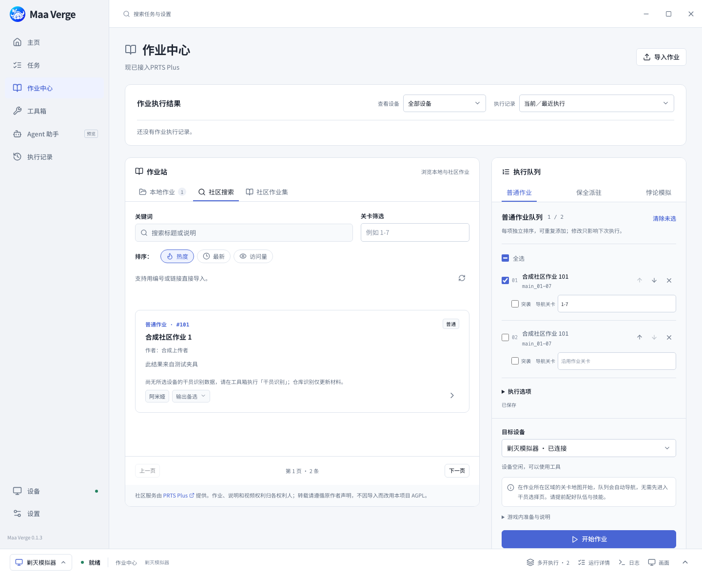
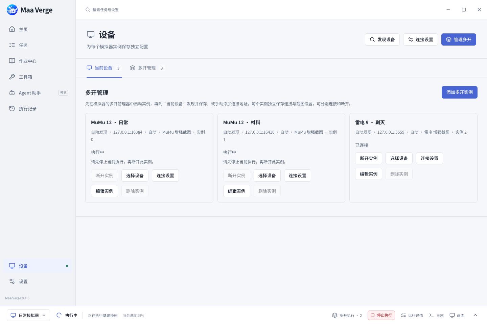
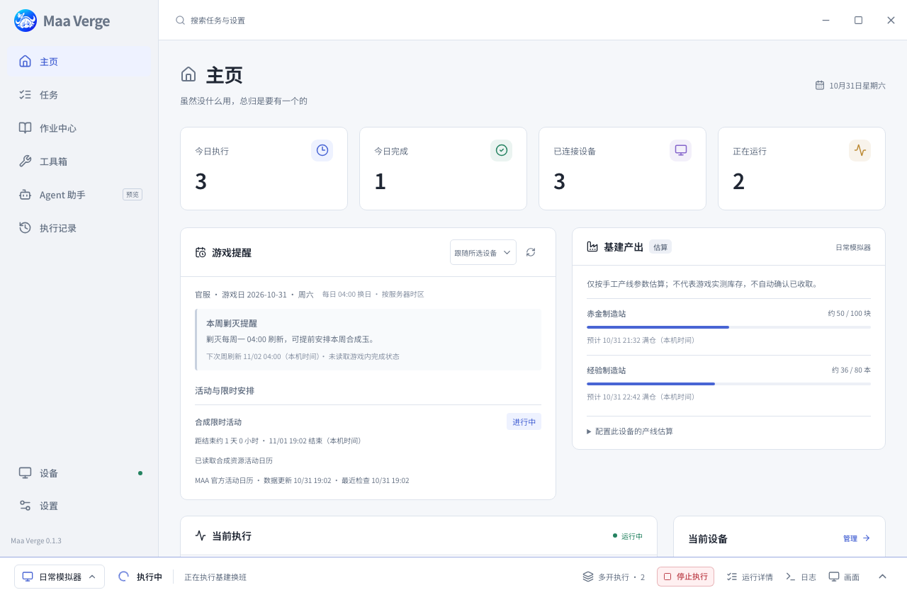
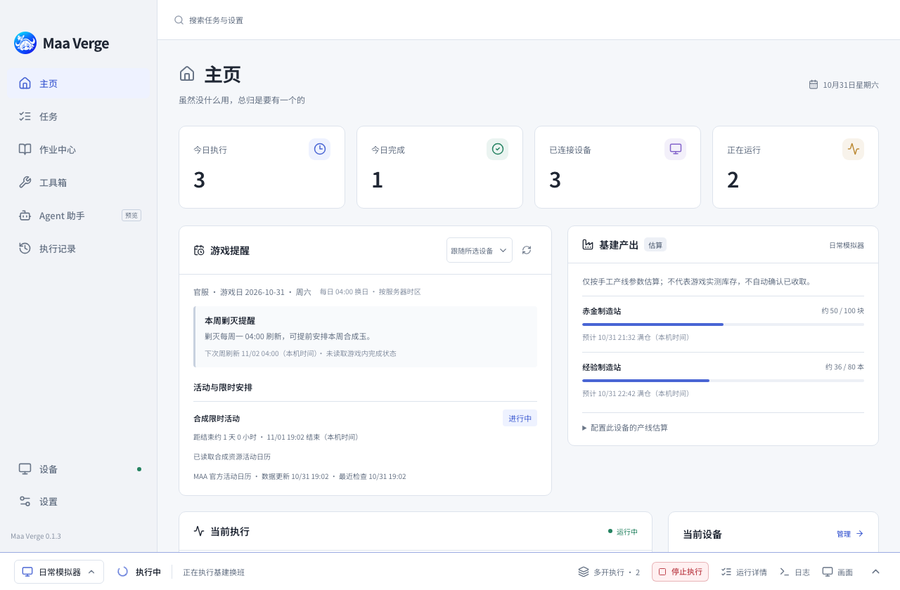

  

<h1 align="center">Maa Verge</h1>

真正的跨平台 · （未来）真正的PRTS（大嘘） · 正在努力开发中

  <a href="https://github.com/DeathofBrain/maa-verge/releases"><strong>下载软件</strong></a> ·
  <a href="#快速开始">快速开始</a> ·
  <a href="#常见问题">常见问题</a> ·
  <a href="https://github.com/DeathofBrain/maa-verge/issues">反馈问题</a>

Maa Verge 是一款面向 **Windows、macOS 和 Linux** 的免费开源明日方舟桌面助手，基于 [MAA](https://github.com/MaaAssistantArknights/MaaAssistantArknights) 的自动化核心。把基建、公招、自动作战等日常安排成任务表，在一个窗口中连接多个模拟器实例，为各设备选择任务、查看进度并分别停止执行。

> 当前版本为 **[v0.1.3 正式版](https://github.com/DeathofBrain/maa-verge/releases/tag/v0.1.3)**，带来新的任务中心、多设备执行监控、作业库与下载更新体验。完整变化和验证边界见[版本说明](https://github.com/DeathofBrain/maa-verge/blob/v0.1.3/docs/releases/v0.1.3.md)。

> **Agent 功能将于后续 v1.0.0 版本推出，敬请期待。** 当前版本暂不提供 AI 托管或视觉自主操作。

## 下载与安装

从 **[GitHub Releases](https://github.com/DeathofBrain/maa-verge/releases)** 选择系统与架构，或直接下载下表中的 v0.1.3 安装包。

| 系统目标                                      | 安装包                                                                                                                                                                                                                        | 安装方式                                                   |
| --------------------------------------------- | ----------------------------------------------------------------------------------------------------------------------------------------------------------------------------------------------------------------------------- | ---------------------------------------------------------- |
| Windows 10 / 11 · x64                         | [EXE（推荐）](https://github.com/DeathofBrain/maa-verge/releases/download/v0.1.3/Maa-Verge_0.1.3_x64-setup.exe) / [完整 ZIP](https://github.com/DeathofBrain/maa-verge/releases/download/v0.1.3/Maa-Verge_0.1.3_x64-full.zip) | 运行安装程序；ZIP 完全解压到可写目录后运行 `Maa Verge.exe` |
| macOS 15+ · Apple Silicon（M 系列）           | [DMG · aarch64](https://github.com/DeathofBrain/maa-verge/releases/download/v0.1.3/Maa-Verge_0.1.3_aarch64.dmg)                                                                                                               | 打开映像，将应用拖入「应用程序」                           |
| macOS 15+ · Intel                             | [DMG · x64](https://github.com/DeathofBrain/maa-verge/releases/download/v0.1.3/Maa-Verge_0.1.3_x64.dmg)                                                                                                                       | 打开映像，将应用拖入「应用程序」                           |
| Linux · x64（以 Ubuntu 22.04 / 24.04 为目标） | [AppImage](https://github.com/DeathofBrain/maa-verge/releases/download/v0.1.3/Maa-Verge_0.1.3_amd64.AppImage)                                                                                                                 | 赋予执行权限后运行                                         |

Release 页的安装包位于 **Assets**；**Source code** 为源码归档，普通使用无需下载。下载后可用 [SHA256SUMS.txt](https://github.com/DeathofBrain/maa-verge/releases/download/v0.1.3/SHA256SUMS.txt) 核对文件。

- **游戏与模拟器**：自行安装安卓模拟器和明日方舟，开启 ADB 调试，并完成游戏登录。
- **首次组件准备**：Windows EXE 默认勾选 MaaCore 与 MaaResource，可按需取消；完整 ZIP 已包含两者。首次启动会校验并导入随附组件。未附带组件时，以及 macOS / Linux 首次使用时，需要联网下载核心和资源，无需另装 Python、Node.js、Bun 或下载工具。
- **系统依赖**：Windows 使用 WebView2，缺少时安装程序会引导安装，ZIP 用户需自行准备；Linux 需要系统 WebKit / GTK 等桌面库及 AppImage 所需的 FUSE，其他发行版需自行确认依赖。

Windows 安装包尚无发布者签名；macOS 采用完整的本地签名（ad-hoc），尚无 Developer ID 签名与公证。macOS 首次打开可能需要在「系统设置 → 隐私与安全性」选择「仍要打开」，详见[安装与首次放行](https://github.com/DeathofBrain/maa-verge/blob/v0.1.3/docs/app-updates.md#macos-签名与首次放行)。应用内更新另有更新签名校验，两者用途不同。

也可在「设置 → 更新 → Mirror酱」配置 [Mirror酱](https://mirrorchyan.com?source=maa_verge_readme)。**Mirror酱用户端的高速下载是付费服务，需要有效 CDK**；Maa Verge 本身免费开源，GitHub 官方免费下载继续保留，详见[服务说明](https://github.com/DeathofBrain/maa-verge/blob/v0.1.3/docs/mirrorchyan.md)。

## 能做什么

- **安排日常任务**：创建、复制和排序任务表，逐项设置参数与启停状态；编辑后自动保存，常用操作可通过右键菜单完成。
- **在一个窗口中管理多开**：保存各模拟器实例的连接设置，一张任务表可在多个设备上独立执行，也可为不同设备安排不同任务表。
- **按设备查看执行**：在「任务 → 执行监控」切换设备，查看任务进度、材料掉落、基建反馈与失败原因；底栏随时打开运行详情、日志和画面，支持单独或批量停止。
- **管理与执行作业**：从本地 JSON 或 PRTS Plus 预览导入普通、保全、悖论作业与作业集，整理本地分类、批量入队，保留来源署名并查看干员需求。
- **使用工具与每日定时**：识别仓库与干员、计算公招标签、按目标补货，为已保存的任务表安排每日执行；识别结果保留采集时间并可导出。
- **分别更新软件、核心和资源**：统一下载代理、进度与安全续传，核心和资源在设备空闲时生效；本地保存任务表、设置和执行记录，支持浅色与深色主题。

> **基建估算目前为草稿模块，更多、更全面的功能尚待开发。**

### 平台与模拟器

三平台共用任务表、作业库和多设备管理界面，**通用连接方式为 ADB**；具体模拟器能否使用，还取决于它在对应系统上的版本与 ADB 支持。

| 模拟器 / 连接方式                  | 当前接入能力                                                   | 使用边界                                                                            |
| ---------------------------------- | -------------------------------------------------------------- | ----------------------------------------------------------------------------------- |
| Windows MuMu                       | 读取已启动实例的名称、编号与实际 ADB 地址，可自动配置增强截图  | 支持不同安装目录和非默认端口；增强截图需匹配本机 SDK 与实例                         |
| Windows 雷电                       | 根据实例信息及端口归属发现设备，可自动配置增强截图             | 需匹配运行实例与本机 SDK；真实设备验收仍待完成                                      |
| BlueStacks、夜神等 ADB 模拟器      | 查找常见 ADB 路径及已知本机地址；BlueStacks 可读取实例端口配置 | 自动识别失败时手动填写地址与 ADB，具体系统和版本需自行确认                          |
| 其他可通过 ADB 访问的模拟器 / 设备 | Windows、macOS、Linux 均可手动配置连接                         | 增强截图仅适用于上述 Windows MuMu / 雷电；PlayCover 与 Windows 原生游戏窗口尚未接入 |

当前实机记录覆盖**一个 Windows MuMu 实例的连接与增强截图**；真实多开、雷电、不同游戏客户端及 macOS / Linux 的设备操作仍待分别验收。平台目标与合成测试通过不代表所有模拟器均已实测，详细条件见[连接说明](https://github.com/DeathofBrain/maa-verge/blob/v0.1.3/docs/emulator-connection.md)与[多开说明](https://github.com/DeathofBrain/maa-verge/blob/v0.1.3/docs/multi-instance.md)。Maa Verge 管理的是已启动实例，不自动创建或启停模拟器。

### 界面预览

以下图片均为 **v0.1.3 的合成测试数据截图**，不含真实账号信息，不代表真实设备或游戏执行结果。

任务中心：配置任务表与查看多设备执行

作业中心与模拟器实例配置

软件、核心与游戏资源更新

Windows、macOS 与 Linux 界面

以下为同一测试场景在 Chromium 中模拟平台差异的界面展示，不代表在三个系统上的原生运行或实机验证。

## 快速开始

1. **启动模拟器**。开启 ADB 调试，打开游戏并完成需要手动处理的登录。
2. **打开 Maa Verge**。等待首次组件准备完成，可在「设置 → 更新」查看状态。
3. **连接设备**。进入「设备」，点击「发现设备」并连接对应条目，也可使用自动连接。多开时通过「管理多开」保存各实例设置，核对实例名称、地址与当前设备。
4. **配置任务表**。进入「任务」，点击「新建任务表」，添加并安排任务，检查客户端、关卡、次数及理智药和源石数量；编辑后自动保存，开始前确认显示「已保存」。
5. **开始与查看结果**。点击任务表的「开始执行」，选择设备；也可勾选多张表后点击「运行」。在「执行监控」查看各设备状态，通过底栏打开日志与画面，历史结果保存在「执行记录」。

新建任务默认不使用理智药或源石，使用前须明确设置数量。消耗额度按**每次执行**分别授权，同一张表在多个设备运行时，各次执行会分别使用自己的额度。**停止会结束并清空当前原生任务队列，不支持暂停后续跑。**

要在多个实例上运行同一张任务表，可在启动窗口多选设备；常用组合可保存为任务表与设备的绑定。每台设备同一时间只能执行一项任务，也请只交给一个助手控制。未配置定时计划时，任务需手动开始。

更多用法：[任务设置](https://github.com/DeathofBrain/maa-verge/blob/v0.1.3/docs/maa-task-settings.md) · [设备绑定](https://github.com/DeathofBrain/maa-verge/blob/v0.1.3/docs/task-device-bindings.md) · [多开说明](https://github.com/DeathofBrain/maa-verge/blob/v0.1.3/docs/multi-instance.md) · [工具箱与定时](https://github.com/DeathofBrain/maa-verge/blob/v0.1.3/docs/toolbox-schedules.md)

## 常见问题

### 找不到或连不上模拟器怎么办？

确认模拟器已启动、ADB 调试已开启，并处理模拟器里的授权提示，再到「设备」重新发现。自动识别失败时，手动填写连接地址并选择模拟器自带的 ADB。修改配置后先停止任务、断开，再重新连接；增强截图失败时可明确改选 ADB，详见[连接设置](https://github.com/DeathofBrain/maa-verge/blob/v0.1.3/docs/connection-settings.md)。

### 下载失败或速度较慢怎么办？

在「设置 → 更新」查看错误和实际下载来源，检查网络及目录写入权限，再重试。应用、核心和资源共用内置 HTTP 下载及「下载代理」，可选择自动、手动 HTTP/HTTPS 代理或直连；中断后会核对文件来源再尝试续传。Mirror酱为可选付费加速来源，官方免费来源继续保留。

### 软件、核心和游戏资源怎么更新？

在「设置 → 更新」分别检查。应用更新下载并校验后，可选择「立即更新并重启」或「下次启动时更新」；后者须真正退出再打开，最小化到托盘不会安装。Windows EXE、macOS DMG、Linux AppImage 使用对应完整安装包更新，ZIP 版须备份后手动更新。

**旧 MSI、Linux DEB / RPM 及仅支持旧更新归档的 macOS 版本需手动迁移一次**，具体步骤见[本版升级说明](https://github.com/DeathofBrain/maa-verge/blob/v0.1.3/docs/releases/v0.1.3.md#升级说明)。安装前完全退出并备份，macOS 需确认系统为 15 或更新版本。

应用、MaaCore 和游戏资源独立管理，核心已是最新版时仍可能有资源更新。核心与资源等待所有设备安全空闲后切换，失败时保留原组合；应用内版本回滚暂不支持。

### 支持定时执行和 AI 托管吗？

支持每日定时，AI 托管尚未开放。在已保存任务表的「定时计划」中选择设备和时间，应用运行期间按电脑本地时间触发；普通定时遇到设备忙时跳过，退出或休眠期间错过的触发不补跑。

Windows 提供默认关闭的提前唤醒选项，受硬件和电源策略影响，实际休眠恢复与定时游戏流程仍待验收；macOS / Linux 不支持系统唤醒。详见[定时使用与限制](https://github.com/DeathofBrain/maa-verge/blob/v0.1.3/docs/toolbox-schedules.md)。**Agent 功能将于后续 v1.0.0 版本推出，敬请期待。**

### 配置、作业和执行记录如何备份？

**完全退出应用**后，备份整个 `config` 文件夹，以及自行选择的作业 JSON 目录。默认 `config` 与程序并列：macOS 位于 `.app` 同级，Linux 位于 AppImage 同级；数据库、执行记录和结果截图在其中的 `native` 子目录。使用自定义数据根时以实际位置为准，可在「设置 → 数据与诊断 → 配置文件」查看和选择下次启动的位置，选择目录不会自动搬移旧数据。

从 v0.1.0 升级或迁移电脑时，请一并保留旧数据和仍被引用的自定义组件目录，详见[数据目录与迁移](https://github.com/DeathofBrain/maa-verge/blob/v0.1.3/docs/runtime-migration.md#数据交接与回退)。

### macOS 卸载后为什么还有核心和资源？

macOS 默认将核心和资源保存在用户的 `Library/Application Support/Maa Verge/`，与应用包分开。可通过「设置 → 关于 → 卸载 Maa Verge」将当前应用及默认组件移到废纸篓，保留配置和自定义目录；直接在 Finder 删除应用不会清理组件。详见[组件目录](https://github.com/DeathofBrain/maa-verge/blob/v0.1.3/docs/maacore-runtime.md#下载与安装目录)。

### 会向外部服务发送数据吗？

设置与执行记录保存在本机。活动日历、下载和更新会访问相应网络服务；社区作业搜索、预览和导入会访问 PRTS Plus，手动评价或启用默认关闭的通关后自动点赞会向该服务提交评价。新建自动作战任务的掉落汇报与原版 MAA 默认一致，可在任务设置中关闭向企鹅物流和一图流汇报。

## 遇到问题

欢迎在 **[GitHub Issues](https://github.com/DeathofBrain/maa-verge/issues)** 反馈，请附上：

- 系统版本、Maa Verge 版本，以及设置中显示的 MaaCore 和资源版本。
- 模拟器名称与版本、复现步骤、预期结果和实际提示。
- 必要的错误截图与日志，可在「设置 → 数据与诊断」点击「导出日志」获取。

分享前请检查截图与记录中的账号、凭据和本地路径等个人信息。

## 参与与致谢

参与开发或从源码构建，请阅读[贡献指南](CONTRIBUTING.md)和[开发文档](docs/development.md)。开发进展见[开发状态](docs/STATUS.md)，后续路线见[项目计划](PLAN.md)。

感谢 [MaaAssistantArknights](https://github.com/MaaAssistantArknights/MaaAssistantArknights) 提供自动化核心，以及 [MaaResource](https://github.com/MaaAssistantArknights/MaaResource) 提供游戏资源。

Maa Verge 采用 [AGPL-3.0-only](LICENSE) 开源协议，是独立社区项目，不代表明日方舟官方或 MaaAssistantArknights 官方客户端。

本项目 Logo 参考《明日方舟》角色「帕拉斯」，由 `gpt-image-2.5-flare` 生成并经后期处理。角色形象的相关权利归原权利人所有；本项目的开源许可不代表获得相关第三方权利的授权，Logo 的使用也不代表游戏官方的授权或认可。
