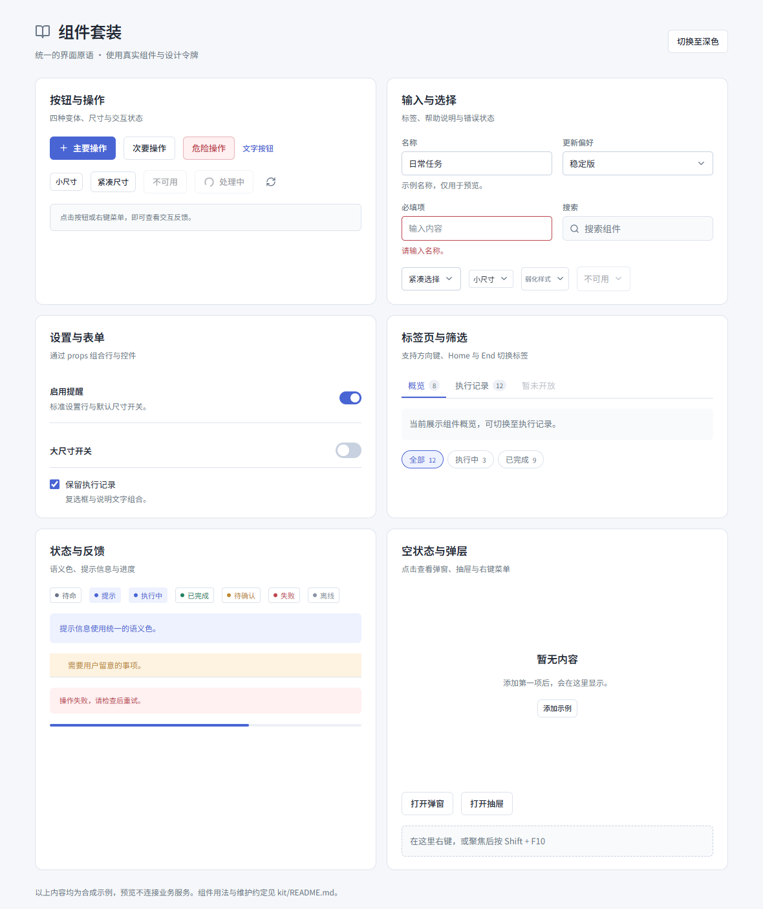
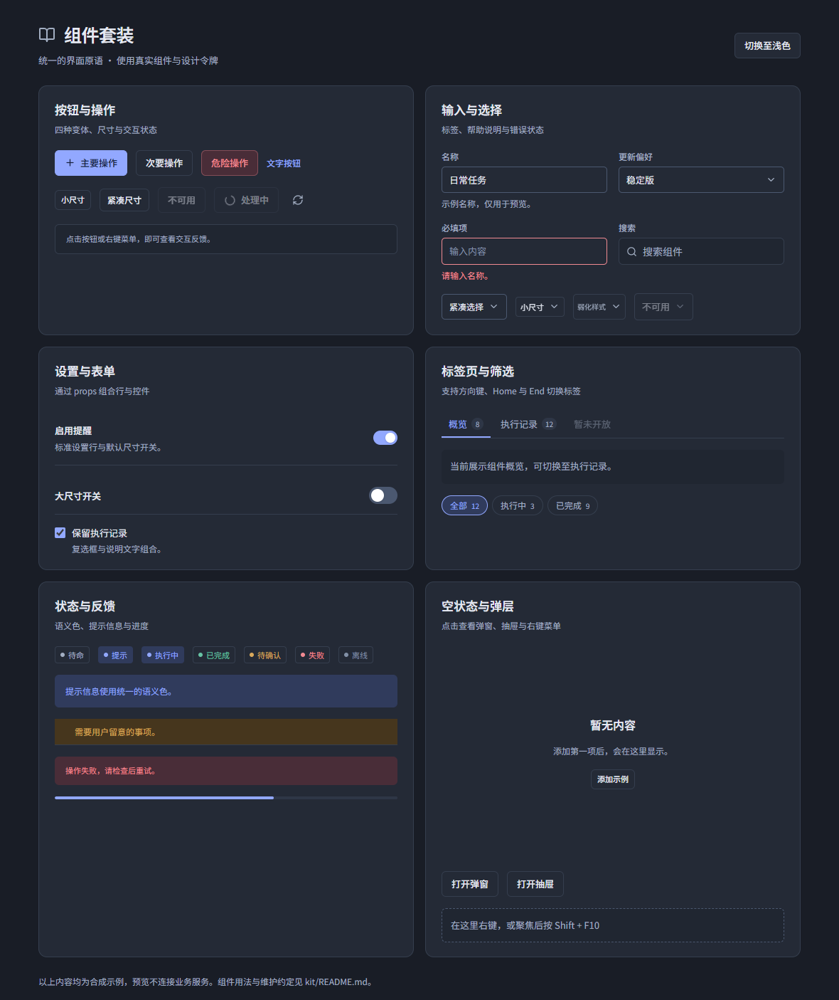

# Maa Verge Kit

桌面界面的基础组件、统一样式和弹层机制。业务页面优先复用这里的组件，业务状态和操作仍由 `features/`、`app/` 与类型化传输负责。

本文只维护快速示例与预览入口。修改 kit 前先确认现有 props、插槽和页面布局能否满足需求，并遵守规范中的[维护边界](../../../../docs/component-kit.md#维护边界)。

完整 API、设计令牌、可访问性与 CSS 规则以[组件套装规范](../../../../docs/component-kit.md)为准；开发流程见[组件套装 skill](../../../../.skill/maa-verge-component-kit/SKILL.md)。

## 样式预览

以下图片由真实 kit 组件和应用令牌渲染，内容为合成示例。

浅色：



深色：



从仓库根启动纯前端服务：

```powershell
pnpm dev:ui
```

打开 <http://localhost:1420/kit-preview.html>，可切换主题，操作表单、下拉框、标签页、右键菜单、对话框与抽屉。也可以用 `?theme=light` / `?theme=dark` 指定初始主题；配置了其他开发端口时替换 URL 中的端口。

[预览入口](../../kit-preview.html)与[预览源码](../../docs/kit-preview.tsx)仅用于文档展示，不加载产品 App 或原生服务。预览页的 CSS 只负责展示容器布局；组件外观直接来自 `kit.css`。修改 kit 后应检查实时预览，并更新有变化的图片；浏览器预览不代表三平台原生 WebView 已验证。

## 导入与快速示例

跨目录使用 `@/`，直接导入需要的组件；纯格式化与文案映射从 `@/kit/format`、`@/kit/labels` 深导入。入口已统一加载 `kit.css`，页面不重复导入。组件清单和各项参数以[组件套装规范](../../../../docs/component-kit.md#组件清单)为准，以下示例只展示组合方式。

```tsx
import Button from '@/kit/Button';
import Field from '@/kit/Field';
import TextField from '@/kit/TextField';
import { formatDuration } from '@/kit/format';
```

### 按钮

```tsx
<>
  <Button variant="primary" busy={saving} disabled={saving} onClick={save}>
    保存
  </Button>
  <Button size="compact" onClick={refresh}>
    刷新
  </Button>
  <Button variant="danger" onClick={remove}>
    删除
  </Button>
</>
```

### 带标签的输入与下拉框

```tsx
<>
  <Field label="名称" help="仅保存在本机">
    {(id) => (
      <TextField
        id={id}
        value={name}
        onChange={(event) => setName(event.target.value)}
        aria-describedby={`${id}-help`}
      />
    )}
  </Field>
  <Field label="执行模式">
    {(id) => (
      <Select id={id} value={mode} onChange={(event) => setMode(event.target.value)}>
        <option value="once">执行一次</option>
        <option value="repeat">循环执行</option>
      </Select>
    )}
  </Field>
</>
```

### 对话框与抽屉

```tsx
<>
  {open && (
    <Modal
      title="确认操作"
      onClose={() => setOpen(false)}
      footer={<Button onClick={() => setOpen(false)}>完成</Button>}
    >
      请核对操作内容。
    </Modal>
  )}
</>
```

表单标签、`busy`、Select、Tabs、右键菜单和弹层的完整约定见[组件 API 与布局模式](../../../../docs/component-kit.md#组件-api-与布局模式)及[可访问性契约](../../../../docs/component-kit.md#可访问性契约)。

## 维护入口

样式规则与维护边界只在[组件套装规范](../../../../docs/component-kit.md)维护；修改步骤见[组件套装 skill](../../../../.skill/maa-verge-component-kit/SKILL.md)，统一定向与全量命令见[开发指南](../../../../docs/development.md#检查与测试)。必要变更同步受影响的规范、示例和预览，实际命令、平台、结果与未验证项记录到任务或 PR。
