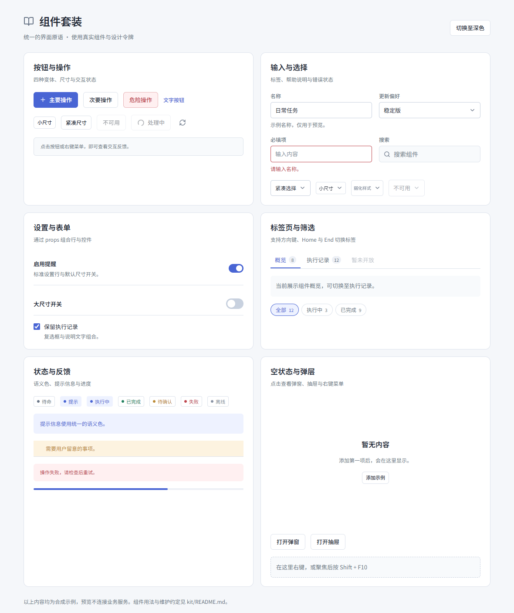
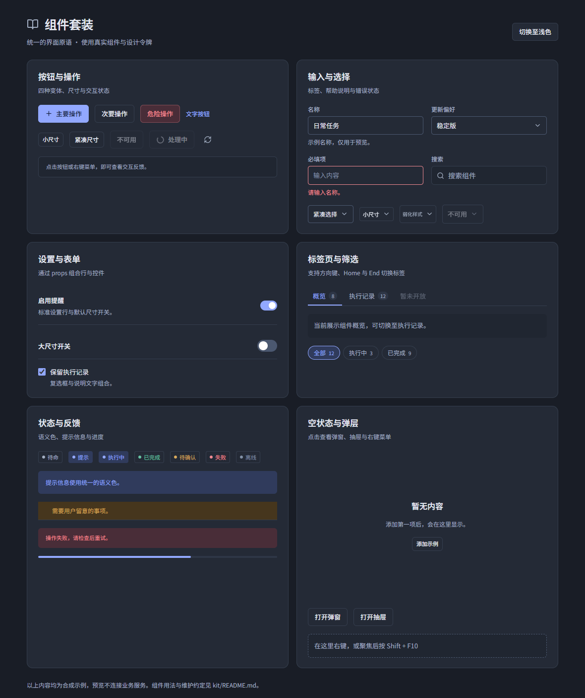

# Maa Verge Kit

桌面界面的基础组件、统一样式和弹层机制。业务页面优先复用这里的组件，业务状态和操作仍由 `features/`、`app/` 与类型化传输负责。

**如无必要，不得修改 kit 的组件代码与样式。** 先使用现有 props、插槽和页面自己的布局容器。只有修复真实缺陷、可访问性问题，或补充现有 API 无法表达的通用能力时，才修改 kit；单个页面的视觉偏好、临时对齐和顺手重构不构成修改理由。确需修改时，说明原因和受影响的使用方，同步文档并完成相关验证。

完整 API、设计令牌、可访问性与 CSS 规则以[组件套装规范](../../../../docs/component-kit.md)为准；开发流程见[组件套装 skill](../../../../.skill/maa-verge-component-kit/SKILL.md)。

## 样式预览

以下图片由真实 kit 组件和应用令牌渲染，内容为合成示例。

浅色：



深色：



从仓库根启动纯前端服务：

```powershell
pnpm dev:ui
```

打开 <http://localhost:1420/kit-preview.html>，可切换主题，操作表单、下拉框、标签页、右键菜单、对话框与抽屉。也可以用 `?theme=light` / `?theme=dark` 指定初始主题；配置了其他开发端口时替换 URL 中的端口。

[预览入口](../../kit-preview.html)与[预览源码](../../docs/kit-preview.tsx)仅用于文档展示，不加载产品 App 或原生服务。预览页的 CSS 只负责展示容器布局；组件外观直接来自 `kit.css`。修改 kit 后应检查实时预览，并更新有变化的图片；浏览器预览不代表三平台原生 WebView 已验证。

## 导入与样式

跨目录使用 `@/`，直接导入需要的组件：

```tsx
import Button from '@/kit/Button';
import Field from '@/kit/Field';
import TextField from '@/kit/TextField';
import { formatDuration } from '@/kit/format';
```

组件也可从 `@/kit` 具名导入。纯格式化与文案映射从 `@/kit/format`、`@/kit/labels` 深导入。

`main.tsx` 已统一加载 `./kit/kit.css`，并保持它是模块图中的第一个样式表；页面不重复导入。设计令牌定义在 `app/styles/styles.css`，主题通过根元素的 `data-theme` 切换。

## 常用组件速查

| 用途       | 组件                                                                                                         | 常用参数 / 约定                                                                                             |
| ---------- | ------------------------------------------------------------------------------------------------------------ | ----------------------------------------------------------------------------------------------------------- |
| 操作       | `Button`、`IconButton`、`ExternalLink`                                                                       | Button：`variant="primary/secondary/danger/text"`、`size="md/compact/sm"`、`busy`；图标按钮必须提供 `label` |
| 表单       | `Field`、`TextField`、`NumberField`、`TextArea`、`RangeField`                                                | Field 提供标签；输入组件透传原生属性，`invalid` 表达错误样式                                                |
| 选择       | `Select`、`Checkbox`、`CheckField`、`Switch`                                                                 | Select 使用原生 `<option>` / `<optgroup>`；Switch 的 `onChange` 接收布尔值                                  |
| 搜索与导航 | `SearchField`、`Tabs`、`FilterChips`                                                                         | SearchField 使用 `value/onValueChange`；Tabs 必填 `aria-label`、`idPrefix`                                  |
| 页面结构   | `PageHeading`、`Section`、`SettingRow`、`ListRow`、`SelectableRow`                                           | 使用 `actions/control/footer/children` 等插槽组合；布局归页面                                               |
| 状态反馈   | `StatusPill`、`Notice`、`ErrorBanner`、`EmptyState`、`ProgressBar`、`Spinner`、`Toast`、`SaveStateIndicator` | StatusPill 用 `label/tone`；ProgressBar 必填 `value/label`                                                  |
| 目录       | `DirectoryPicker`                                                                                            | 展示路径与选择操作；实际目录选择由使用方回调完成                                                            |
| 弹层       | `Modal`、`Drawer`、`ConfirmDialog`、`Overlay`、`useNativeDialog`                                             | 统一焦点、Escape、背景 inert 和滚动锁；普通弹层按条件挂载                                                   |
| 右键菜单   | `ContextMenuProvider`、`useContextMenu`                                                                      | 从 `@/kit/ContextMenu` 导入；Provider 由应用入口统一挂载                                                    |

表中斜杠分隔的是可选值，例如 `variant="primary"`，不传入整段 `primary/secondary/...`。

## 使用示例

### 按钮

```tsx
<>
  <Button variant="primary" busy={saving} disabled={saving} onClick={save}>
    保存
  </Button>
  <Button size="compact" onClick={refresh}>
    刷新
  </Button>
  <Button variant="danger" onClick={remove}>
    删除
  </Button>
</>
```

默认 `type="button"`，表单提交需显式传 `type="submit"`。`busy` 显示加载图标，不会自动禁用按钮；需要阻止重复操作时同时传 `disabled`。

### 带标签的输入与下拉框

```tsx
<>
  <Field label="名称" help="仅保存在本机">
    {(id) => (
      <TextField
        id={id}
        value={name}
        onChange={(event) => setName(event.target.value)}
        aria-describedby={`${id}-help`}
      />
    )}
  </Field>
  <Field label="执行模式">
    {(id) => (
      <Select id={id} value={mode} onChange={(event) => setMode(event.target.value)}>
        <option value="once">执行一次</option>
        <option value="repeat">循环执行</option>
      </Select>
    )}
  </Field>
</>
```

Field 的函数式 children 接收生成的 id，用它关联标签。错误状态按需同时设置 `invalid` 和 `aria-invalid`。Select 不接受 `options` 数组，也不支持 `multiple`；菜单定位、原生表单语义与键盘操作由组件维护。

Select 使用 `size="md"`（默认）、`"compact"` 或 `"sm"` 控制尺寸，`variant="subtle"` 弱化边框与文字并缩小字号；`textSize="sm"` / `"md"` / `"base"` 对应 11 / 12 / 13px 字号。页面只设置自己的宽度与布局，不修改内部样式。

### 设置行与状态

```tsx
<>
  <SettingRow
    title="启用提醒"
    description="执行结束后显示通知"
    control={<Switch checked={enabled} onChange={setEnabled} aria-label="启用提醒" />}
  />
  <StatusPill label="执行中" tone="running" dot />
  <ProgressBar value={45} label="执行进度" />
  <Notice tone="warning">请先完成配置。</Notice>
</>
```

SettingRow 的标题不会自动成为 Switch 的可访问名称，需要显式传 `aria-label`。StatusPill 使用 `label`，不使用 children。

### 标签页

```tsx
<>
  <Tabs
    aria-label="内容视图"
    idPrefix="example"
    items={[
      { id: 'overview', label: '概览' },
      { id: 'details', label: '详情' },
    ]}
    value={tab}
    onChange={setTab}
  />
  {['overview', 'details'].map((id) => (
    <section
      key={id}
      role="tabpanel"
      id={`example-panel-${id}`}
      aria-labelledby={`example-tab-${id}`}
      hidden={tab !== id}
    >
      {id === 'overview' ? '概览内容' : '详情内容'}
    </section>
  ))}
</>
```

每组 Tabs 的 `idPrefix` 必须唯一，内容面板由页面提供；方向键、Home、End 与焦点切换由组件处理。

### 对话框与抽屉

```tsx
<>
  {open && (
    <Modal
      title="确认操作"
      onClose={() => setOpen(false)}
      footer={<Button onClick={() => setOpen(false)}>完成</Button>}
    >
      请核对操作内容。
    </Modal>
  )}
</>
```

Modal 和 Drawer 没有 `open` 属性，通过条件挂载控制显示。普通对话框使用 Modal，侧边详情使用 Drawer，需要确认动作使用 ConfirmDialog。独立页面的背景不同于应用外壳时，传入 `background`；通过 `returnFocus` 等参数处理自定义焦点目标。不自行实现 Tab 陷阱、Escape、滚动锁或焦点恢复。

### 右键菜单

```tsx
import { useContextMenu } from '@/kit/ContextMenu';

function ExampleRow() {
  const contextMenu = useContextMenu();
  return (
    <div tabIndex={0} {...contextMenu('示例操作', [{ label: '复制名称', action: copyName }])}>
      示例条目
    </div>
  );
}
```

使用方需位于 ContextMenuProvider 内；桌面入口已挂载，独立预览需要自己挂载。支持右键和 Shift+F10，菜单项通过 `disabled/danger` 表达禁用及危险操作。

## 样式与维护边界

- 尺寸、语义色和变体使用现有 props。页面通过自己的容器和插槽设置布局；`className` 用于页面自有根类，不用来重写组件内部外观。
- 页面 CSS 不得引用 `.mv-*`、组件内部节点或祖先前缀覆盖链。不能通过复制 kit CSS、`!important` 或放宽门禁绕过约定。
- kit 原语样式统一放在 `kit.css`，只使用规范允许的 `.mv-*` 选择器；不另建组件样式表，不混入页面布局。
- kit 不引入设备、任务、作业等业务状态，不直接操作 Shell、ADB、MaaCore 或业务数据库；业务请求经过 `@maaverge/contracts`。
- 必要变更应保持中文可访问名称、表单语义、菜单 portal 和焦点行为，检查全部使用方，并同步本 README、预览与规范中的相关内容。
- **禁止添加外观断言测试。** 样式通过人工检查真实组件截图验证；交互变化运行相关行为测试。

必要修改后的基础检查从仓库根执行：

```powershell
pnpm --filter @maaverge/desktop check
node tools/check-kit-css.mjs
node tools/check-frontend-architecture.mjs
pnpm exec prettier --check <改动文件>
```

再按影响范围执行行为测试和项目检查，记录实际平台、结果与未验证项到 [STATUS](../../../../docs/STATUS.md)。
