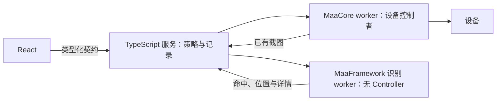

# MaaCore 细粒度接口与 MaaFramework 补充接入调研

调研日期：2026-10-25。状态：文档与源码核查，尚未实现新的原生接口或 MaaFramework 适配器，未运行二进制原型、连接设备或验证真实游戏行为。

本地核查基于 `2ea732a` 及当前工作区。MaaCore 以项目基线 v6.20.0 为主，并核对最新稳定版 v6.20.1；两版公开 `AsstCaller.h` 和本文涉及的基建核心实现相同。MaaFramework 以当日最新稳定版 [v5.14.3](https://github.com/MaaXYZ/MaaFramework/releases/tag/v5.14.3) 为准，发布于 2026-10-10，对应提交 `8963191215ca49d6b037802acd07d20a4213160a`。下文区分上游已有能力、本项目已接能力与实施建议。

## 结论

MaaCore 有比整项业务任务更细的接口，也有未充分公开的内部信息。应逐项确认缺口：已有公开入口优先接入；内部已经掌握的游戏结果优先考虑补回调；需要通用识别、自由组合流程和独立动作时，再引入 MaaFramework。

对于“基建换班时返回设施和所选角色”，现有接口只能部分满足。设施与房间可以返回，自定义排班可以返回指定名单，但确认回调不返回最终名单，普通自动换班也没有完整的公共人员结果。这个需求更适合先研究 MaaCore 的小范围回调扩展。

若继续验证 MaaFramework，建议首个原型只接收现有截图进行 OCR／模板匹配，不创建设备 Controller；动作与 Pipeline 执行另设阶段。MaaCore 继续负责日常、基建和成熟作业能力。

## 基建换班：现有接口究竟返回什么

基建信息通过 `AsstCreateEx` 注册的回调异步推送，不是 `AsstAppendTask` 的同步返回值。任务追加返回的是任务 ID。

| 所需信息                       | MaaCore v6.20.0／v6.20.1 行为                                                                                      | 可作出的判断                                                       |
| ------------------------------ | ------------------------------------------------------------------------------------------------------------------ | ------------------------------------------------------------------ |
| 当前设施和房间                 | `EnterFacility` 及基建基础信息带 `details.facility`、`details.index`                                               | 能确定设施类型和从 0 开始的房间序号；不是完整的建筑布局坐标        |
| 自定义排班的指定人员           | `CustomInfrastRoomOperators` 带 `names`、`candidates`                                                              | 选择开始前的配置名单和候补名单，不能据此确定候补最终选中了谁       |
| 确认换班                       | `InfrastConfirmButton` 在确认流程成功后发出，带设施和序号                                                          | 核心报告确认流程成功；没有独立返回最终人员，也没有逐人进驻复核结果 |
| 普通自动换班选中了谁           | 内部有选人计算和部分身份缓存，公共回调没有完整人员结果                                                             | 不能仅从任务完成事件还原最终名单                                   |
| 设施产物                       | `ProductOfFacility` 带 `product`                                                                                   | 能知道产物类别；不能据此推断本次实际加成或产能                     |
| 保持原样、配置缺失或编组不可用 | 有对应的 `CustomInfrastRoomKeptUnchanged`、`CustomInfrastRoomsNotConfigured`、`CustomInfrastRoomGroupsMatchFailed` | 不应把原方案记为已应用                                             |

关键源码：

- [InfrastAbstractTask.cpp:61](https://github.com/MaaAssistantArknights/MaaAssistantArknights/blob/v6.20.0/src/MaaCore/Task/Infrast/InfrastAbstractTask.cpp#L61) 为基础信息补充设施和房间序号。
- [同文件:398](https://github.com/MaaAssistantArknights/MaaAssistantArknights/blob/v6.20.0/src/MaaCore/Task/Infrast/InfrastAbstractTask.cpp#L398) 从 `room_config.names`／`candidates` 生成选人前事件。
- [同文件:962](https://github.com/MaaAssistantArknights/MaaAssistantArknights/blob/v6.20.0/src/MaaCore/Task/Infrast/InfrastAbstractTask.cpp#L962) 确认后提交内部记录、清空 pending，再发送不带名单的确认事件。
- [InfrastProductionTask.cpp:1173](https://github.com/MaaAssistantArknights/MaaAssistantArknights/blob/v6.20.0/src/MaaCore/Task/Infrast/InfrastProductionTask.cpp#L1173) 在普通生产设施选人过程中缓存 `operator_id`；[缓存实现](https://github.com/MaaAssistantArknights/MaaAssistantArknights/blob/v6.20.0/src/MaaCore/Task/Infrast/InfrastAbstractTask.cpp#L41) 说明部分信息已在核心内部。

本项目的 [execution-evidence.ts](../services/backend/src/execution-evidence.ts) 已按设施和房间合并这些事件，区分 `planned`、`confirmed` 和 `unavailable`。[ExecutionPage.tsx](../apps/desktop/src/ExecutionPage.tsx) 已展示设施、房间、方案干员及确认状态，没有人员信息时提示“本次反馈未提供干员名单”。当前边界亦记录在 [运行时迁移说明](runtime-migration.md)。已有合成测试覆盖这些语义，本次没有重新运行或新增真实设备验收。

### 针对此需求的建议

先评估向 MaaCore 上游补充结果回调，或维护一个范围有限的核心补丁。在确认成功、清空 pending 前取得选择快照，输出设施、房间、可识别的干员 ID／名称、来源和完整程度。普通自动选人、指定人员、候补补位、保留人员、宿舍及训练室等路径须分别审计。

`m_pending_operator_ids` 不是已经证明完整的最终入住名单：身份识别可能缺失或有歧义，保留／锁定人员及不同设施路径也未必全部进入该集合。新增回调应明确区分“计划”“已选择并确认”“重新观察到进驻”三种证据，不能用字段改名代替验证。

这条路线保留同一核心实例和游戏语义，无需第二个设备控制器。代价是上游协作，或自建核心的版本与发行维护。MaaFramework 若用于补充识别，也仍须开发画面定位、名字／头像识别和结果校验，不会自动读出 MaaCore 的内部名单。

## MaaCore 已有的细粒度能力

| 层级             | 已有能力                                                                                               | 使用边界                                                                                                 |
| ---------------- | ------------------------------------------------------------------------------------------------------ | -------------------------------------------------------------------------------------------------------- |
| 公开 C API       | 异步连接、点击、截图，PNG／BGR 取图，Windows 窗口绑定，任务参数更新及停止                              | 本项目已接截图和点击，尚未接窗口绑定和 BGR；没有独立的公开通用 OCR、模板匹配、Swipe 或按键函数           |
| Custom＋任务资源 | 从指定资源任务节点进入，沿识别和动作链执行                                                             | 可组合已有资源流程；不是任意图片识别服务，部分限制来自 Maa Verge 自己的预算与审核策略                    |
| SingleStep       | 战斗专用 stage／start／action；action 使用 Copilot 解析器，包含部署、技能、撤退、倍速、Click、Swipe 等 | Click／Swipe 可通过任务层触及，但仍走战斗路径并依赖有效关卡地图；不是独立通用控制 API                    |
| 内部 C++ 类      | Controller 的滑动／输入，以及 BattleHelper 的费用、击杀、部署和技能等能力                              | 位于内部源码，不等于可动态加载的稳定外部 SDK；若需导出，必须修改／构建核心并定义线程、生命周期及返回语义 |
| 实验 C API       | `AsstCallerExtra.h` 中的关卡元数据和物品名称查询                                                       | 文件明确声明不属于受支持公共 API，无兼容保证；不是额外的通用动作或识别入口                               |

公开入口见 [AsstCaller.h](https://github.com/MaaAssistantArknights/MaaAssistantArknights/blob/v6.20.0/include/AsstCaller.h)，实验声明见 [AsstCallerExtra.h](https://github.com/MaaAssistantArknights/MaaAssistantArknights/blob/v6.20.0/include/AsstCallerExtra.h)。核对 v6.20.1 后，公开 C API 没有新增细粒度函数。

SingleStep 有需要先做契约探针的细节：[集成文档](https://github.com/MaaAssistantArknights/MaaAssistantArknights/blob/v6.20.0/docs/zh-cn/protocol/integration.md) 将 `details` 描述为单个 action，但[源码](https://github.com/MaaAssistantArknights/MaaAssistantArknights/blob/v6.20.0/src/MaaCore/Task/Interface/SingleStepTask.cpp) 调用 `CopilotConfig::parse_actions(details)`，实际读取 `details.actions` 数组。本项目已按源码校验。

[SingleStepBattleProcessTask](https://github.com/MaaAssistantArknights/MaaAssistantArknights/blob/v6.20.0/src/MaaCore/Task/Experiment/SingleStepBattleProcessTask.cpp) 每个动作批次创建新的执行对象，只有关卡名使用静态缓存；不能假设跨批次保留完整战斗上下文。其执行循环也没有用 `do_action` 返回值决定最终成功，因此任务完成回调不足以证明每个动作成功。

## MaaFramework 能增加的能力

| 方向         | v5.14.3 已公开的能力                                                      | Maa Verge 仍需完成的工作                                 |
| ------------ | ------------------------------------------------------------------------- | -------------------------------------------------------- |
| 通用视觉     | OCR、模板／特征／颜色匹配、ONNX 分类／检测、Custom Recognition            | 模型、模板、ROI、结构化业务状态与准确性验证              |
| 图片独立识别 | `MaaTaskerPostRecognition` 接收现有图片；Tasker 可不绑定 Controller       | 输入帧身份、尺寸、时效、资源版本和结果契约               |
| 单步动作     | Controller 的点击、滑动、按键、触控、文本输入，以及 `MaaTaskerPostAction` | 设备独占、消耗策略、动作后新画面验证、取消和结果不明处理 |
| 自定义流程   | Pipeline 的识别、动作、分支、错误路径和动态覆盖                           | 新活动／小游戏资源及成功标准；不重做已经成熟的 MAA 业务  |
| 多平台控制   | ADB、Win32、macOS、PlayCover、Linux 等控制器                              | 各平台权限、实际目标程序兼容性和设备身份适配             |

依据为 [Tasker C API](https://github.com/MaaXYZ/MaaFramework/blob/v5.14.3/include/MaaFramework/Instance/MaaTasker.h)、[Tasker 初始化源码](https://github.com/MaaXYZ/MaaFramework/blob/v5.14.3/source/MaaFramework/Tasker/Tasker.cpp#L70)、[Pipeline 协议](https://github.com/MaaXYZ/MaaFramework/blob/v5.14.3/docs/zh_cn/3.1-%E4%BB%BB%E5%8A%A1%E6%B5%81%E6%B0%B4%E7%BA%BF%E5%8D%8F%E8%AE%AE.md)和[控制方式说明](https://github.com/MaaXYZ/MaaFramework/blob/v5.14.3/docs/zh_cn/2.4-%E6%8E%A7%E5%88%B6%E6%96%B9%E5%BC%8F%E8%AF%B4%E6%98%8E.md)。macOS 原生控制器要求 14.0＋，不能用“支持 macOS”推断它满足本项目 13.5 的全部功能目标；ADB 路径需另行验证。

MaaFramework 的 AgentServer 是进程外 Custom 识别／动作服务，不等于 LLM Agent。它也不提供明日方舟自动解题器、完整战场状态、第三方插件权限宿主或插件市场。相关能力继续遵守 [插件调研](plugin-marketplace-research.md) 的产品边界。

### 已有复用不能重复计算收益

MaaCore v6.20.0 已使用 MaaFramework 的部分控制单元，[官方下载脚本](https://github.com/MaaAssistantArknights/MaaAssistantArknights/blob/v6.20.0/tools/maafw-control-unit-download.py) 固定 v5.13.0。本项目也已保留这些原生文件，并支持 `MaaFwAdb` 触控模式。单为获得 ADB 驱动或 Windows 窗口连接而完整接入第二引擎，理由不足；应先评估已有接口。

MaaCore 的 `AsstHandle` 与 MaaFramework 的 Controller／Resource／Tasker 没有公开的句柄共享接口。任务格式、资源目录和模型也不能直接混用；可能复用的图片须单独核对尺寸、路径、预处理和许可。

## 推荐接入路径与成本

第一阶段使用独立 C++ 识别 worker，与现有原生隔离边界保持一致。TypeScript 传入既有截图，worker 只加载独立的固定版本识别资源，返回结果，不连接 ADB。

第二阶段再增加独占设备的 MaaFramework 执行器。当前 [native main.cpp](../services/native/src/main.cpp) 在 worker 启动时获取设备租约，直到进程退出才释放，`safeIdle` 不释放锁。首期应在任务边界等待核心停止和异步操作完成，销毁旧 worker 后再交接；切换使旧帧失效，并承认重连成本。不承诺战斗中在两个引擎间切换。

主要工程成本如下：

- 原生依赖、模型、资源与许可均需维护。官方 Windows x64 v5.14.3 完整 ZIP 约 83.3 MB，这只是下载包大小，不是本项目的安装增量；裁剪和内存／耗时须实测。
- 使用独立目录和进程保存两套成套依赖，不替换 MaaCore generation 中的同名控制单元。首期可随应用固定版本升级，再评估独立更新；不能自动用另一引擎替代失败任务。
- 官方 [Node 绑定打包说明](https://github.com/MaaXYZ/MaaFramework/blob/v5.14.3/docs/zh_cn/NodeJS/J1.3-%E6%89%93%E5%8C%85.md) 仍要求 `.node`、原生库及 ADB agent 文件；不能据此推断与 Bun `--compile` 单文件发行兼容。C++ worker 更贴合现有架构。
- [LGPL v3 许可](https://github.com/MaaXYZ/MaaFramework/blob/v5.14.3/LICENSE.md)及依赖声明、对应源码和替换／重建要求应纳入现有发行流程。

## 原型应验证什么

1. 固定版本和识别资源，用合成图片验证 OCR／模板匹配的命中、未命中、坐标和资源错误。完全不创建设备 Controller。
2. 识别结果绑定原帧、设备、worker、时间和坐标空间。MaaCore 预览坐标不是原始设备像素，不能直接作为另一 Controller 的输入。
3. 检查 `GetRecognitionDetail.hit`，而非仅检查任务成功；[RecognitionTask 源码](https://github.com/MaaXYZ/MaaFramework/blob/v5.14.3/source/MaaFramework/Task/RecognitionTask.cpp)显示，未命中也可能生成有效识别任务结果。动作成功同样需由新画面验证。
4. 识别 worker 超时／崩溃不影响既有核心执行。关闭 MaaFramework 默认 stdout 日志，保持 NDJSON 协议独占 stdout；诊断写 stderr 或文件。
5. 测量独立发行产物的依赖完整性、冷启动、识别耗时、内存和包体增量，再决定是否扩大接入。
6. 动作阶段另测共享设备锁、双向交接、异步停止、旧帧失效及超时不重放。上游 Pipeline 含 Command／Shell／Custom 等能力，宿主只开放审核后的有限子集。

纯文档／合成测试不能证明真实基建名单完整或动作有效。真实设备验证需要单独选定场景和版本并记录；本次没有执行这些操作。
