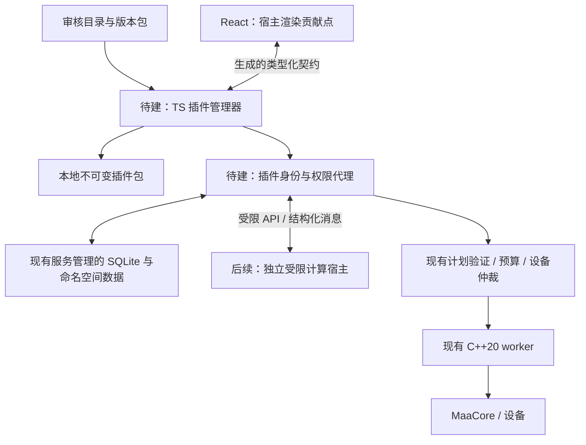

# 插件系统与插件市场调研

调研日期：2026-10-24。状态：未来规划建议，尚未实现、未确定版本或交付日期。本次只核查源码与公开资料，没有运行插件原型或验证三平台插件兼容性。

## 1. 结论

Maa Verge 当前不支持用户安装第三方插件：没有插件包规范、安装管理器、动态贡献点、插件宿主或按插件授权的 API。现有分层架构适合逐步建立这些能力，但增加一个市场页面不足以实现插件化。

建议采用“声明式扩展包 → 本地插件管理 → 审核制市场 → 受限可执行插件”的路线。第一批可以提供任务模板、基建方案、既有格式的作业合集和受限主题；统计或数据处理工具在受限计算宿主验证后开放。插件市场列入后续产品路线，不阻塞现有功能覆盖、发行稳定性与目标平台验收。

首期使用维护者审核的静态目录、固定版本包和客户端本地管理，不要求自建账号云服务。应用、MaaCore、官方资源保持现有三条更新通道；扩展另有自己的目录、版本与更新状态。

## 2. 当前能力与缺口

源码核查以开发基线 `d9e4fec` 及同日工作区为范围；工作区包含正在整合的作业中心与诊断改动。这里描述开发架构，不把未提交内容视为公开发行能力。未来合并本规划时以最新 [开发状态](STATUS.md) 为准。

| 核查点 | 当前入口与行为 | 判断 |
| --- | --- | --- |
| Tauri plugins | [lib.rs](../apps/desktop/src-tauri/src/lib.rs) 的 `.plugin(...)` 注册单实例、应用更新和通知 | 开发者集成的构建依赖；没有用户下载后加载的机制 |
| 业务 RPC | [runtime.ts](../services/backend/src/runtime.ts) 的 `handle` 使用固定方法分派；[transport.ts](../packages/contracts/src/transport.ts) 绑定生成契约 | 没有动态注册、插件调用身份或插件权限检查 |
| 任务与工具 | [runtime.schema.json](../packages/contracts/schemas/runtime.schema.json)、[tasks.ts](../packages/contracts/src/tasks.ts)、[toolbox.ts](../services/backend/src/toolbox.ts) 定义既有类型 | 安装外部文件不能新增任意任务类型或工具 |
| Custom | [task-policy.ts](../services/backend/src/task-policy.ts) 仅允许审核过的小游戏链 | 不是通用脚本入口，不能借此放开原生能力 |
| 界面 | [App.tsx](../apps/desktop/src/App.tsx) 固定导航和页面；[tauri.conf.json](../apps/desktop/src-tauri/tauri.conf.json) 限制脚本与连接来源 | 没有插件页面、面板、命令注册机制 |
| 作业导入 | 开发中的 [copilot.ts](../services/backend/src/copilot.ts) 预览、验证限定 JSON、按 SHA-256 保存不可变版本 | 属于既有执行器的数据输入，可借鉴导入流程；不提供插件代码或新 UI |
| 资源与原生库 | [updates.ts](../services/backend/src/updates.ts) 安装官方核心和资源，worker 加载对应 MaaCore | 官方资源及 MaaCore 控制单元动态库不构成 Maa Verge 用户插件 API |

可复用的基础包括 Schema 生成与校验、下载和归档处理、不可变版本、运行快照、持久请求去重、预算策略、设备仲裁及空闲切换。需要新增的是插件身份、包规范、权限代理、生命周期、贡献点、兼容策略、签名信任及市场治理。

现有 [archives.ts](../services/backend/src/archives.ts) 为核心包保留部分合法链接，大小限额也面向大型原生资产。插件安装不能直接沿用其全部许可范围；应在复用底层校验时设置更严格的包类型与限额。

## 3. 首批扩展的产品范围

| 扩展类型 | 示例 | 建议阶段与边界 |
| --- | --- | --- |
| 任务模板 | 日常流程、剿灭配置、特定养成配置 | 首批；导入为可审阅草稿，仅使用宿主已支持的任务与参数；任务表模板导入本身仍需实现 |
| 配置与方案 | 基建排班、已有功能的配置预设 | 首批候选；明确合并字段，保留本机设备绑定和账号信息，不整包覆盖用户设置 |
| 作业合集 | 普通/保全/悖论的既有格式数据 | 首批候选；复用作业预览、兼容校验和不可变版本，不把安装视为启动 |
| 主题 | 配色和有限设计变量 | 首批可选；宿主校验并渲染，不导入任意 CSS、HTML、JS 或远程字体 |
| 统计及计算工具 | 掉落分析、材料规划、结构化数据转换 | 后续；先只读脱敏数据，再输出结果或计划提案，依赖计算宿主和字段授权 |
| 事件与服务适配 | 通知目标、公开资料源 | 后续；由宿主代理网络、管理凭据，单独处理外发数据权限 |
| 执行及设备扩展 | 新执行步骤、截图分析、控制器适配 | 独立高权限课题；要先定义动作协议、确认点、停止和租约语义，不能直接访问 ADB 或 worker |

模板、作业 JSON 也可能触发消耗或不合适的任务，必须通过宿主的语义、预算、客户端和设备校验。导入包含文件的方案时，由宿主将必要资产保存为用户内容的不可变版本，通过逻辑资产 ID 引用；执行快照再固定解析后的路径与哈希，避免草稿依赖可卸载的插件目录。插件可使用的自动化范围受已公开的宿主 API 与 MaaCore 能力约束，新增底层任务或设备驱动仍需要对应实现与验收。

## 4. 外部方案对比

下表区分官方机制和本项目建议；来源见文末。

| 方案 | 官方机制及限制 | 对 Maa Verge 的取舍 |
| --- | --- | --- |
| Tauri 2 plugins / capabilities [1][2] | 插件由 Cargo crate 和可选 JS bindings 组成；capability 按 window/webview 授权，关联多个 capability 时权限合并 | 继续用于内置系统集成；用户插件另行设计。不能把主窗口权限继承给第三方内容，也不能用窗口 ACL 替代服务端业务权限 |
| VS Code 扩展 [3][4][5][6] | manifest、贡献点、激活条件与独立 extension host；官方明确桌面扩展宿主拥有与 VS Code 相同的权限。Workspace Trust 主要限制不可信工作区触发执行 | 借鉴贡献点、SDK 兼容和惰性激活；独立进程与工作区信任都不等于恶意插件沙箱 |
| Obsidian 社区插件 [7] | 官方说明社区插件继承应用访问级别，无法可靠地做细粒度权限限制 | 开发生态门槛低，但 Maa Verge 持有设备控制和账号画面，不适合直接采用同等权限模型 |
| Extism / Wasm [8][9][10] | 通过 manifest 和 Host Functions 开放宿主能力；运行时可限制内存、网络主机及文件映射等 | 可执行插件的优先候选；默认不开放 WASI 文件系统、原始网络或进程创建，只暴露有限业务 API |
| Open VSX [11] | 面向 VS Code 扩展的开源 registry，含服务、Web 和发布工具 | 借鉴命名空间、发布与治理。Maa Verge 没有 VS Code API，不能直接安装 VSIX；首期无需部署整套 registry |
| 审核制静态目录 | 版本化目录与固定包由客户端获取、验证和缓存 | 首期推荐；使用客户端搜索/筛选与本地状态，后续再考虑账号、评分和开放投稿 |

### 可执行插件的技术验证

Extism JS SDK 宣称支持 Bun，但 README 中的 Bun 测试记录仍为 v1.0.7，且说明 WASI 只部分实现。本次读取固定提交 `bec25c60d0ad32ce06d3934563fd8560f486f323`：源码要求 `timeoutMs` 配合 `runInWorker: true`，worker 路径标为实验性，并拒绝 `ro:` 只读目录映射 [10]。这些资料不能证明固定 Bun 1.4.3 或 `--compile` 发行产物已经兼容。

后续应比较两种原型：独立的 Rust/Wasmtime 或 Extism 原生插件宿主，以及 Extism JS SDK。比较安装包增量、冷启动、调用开销、取消与硬终止、内存/CPU 限额、四个发行目标的打包和 macOS 签名。JS SDK 与原生 SDK 的能力需分别验证，不因名称相同推断一致。

本次不锁定运行时、依赖版本或性能数字。通过原型门槛前不承诺可执行社区插件；直接在 Bun 服务 `import` 第三方 JS、使用 `node:vm` 或只加一个子进程，都不能建立所需权限边界。Node 官方明确 `node:vm` 不是安全机制 [12]。

## 5. 建议架构

下图中的插件管理、权限代理和插件宿主均为待实现部分。TypeScript 继续拥有业务规则和数据库，原生设备路径保持现有职责。

- **界面贡献**：首批仅允许模板、菜单项、配置表单和有限结果组件等声明式结构，由 React 宿主渲染。描述文本按文本处理，表单不执行表达式或远程 Schema 引用。插件不取得主窗口的 Tauri bridge、原始 DOM 或任意页面脚本权限。
- **宿主 API**：按插件身份区分读取摘要、生成草稿、读写私有设置和请求网络等能力。JSON Schema 仍是权威来源，变更后生成类型与校验器。插件协议独立版本化，不直接暴露整个 `Runtime.handle` 或透传任意 RPC 方法名。
- **身份与授权**：身份由管理器在宿主启动和受控通道中绑定，不能相信插件消息自行填写的 ID。每次调用在 TS 服务检查包版本、启用状态、能力与对象范围；不能只在安装时检查一次。
- **业务数据**：只返回声明并授权的字段投影，限制条数与大小；不把完整设置、历史事件、设备路径、账号标识或截图默认交给插件。插件私有 KV 由服务按插件 ID 管理和限额，不让插件打开业务库、运行 SQL 或争抢数据根租约。
- **网络与凭据**：后续按域名和用途授权，由服务代理、限制重定向/大小/超时，防止访问回环、内网和云元数据地址。外发业务数据需独立授权；凭据使用宿主管理的引用，不发送全局密钥或继承完整环境变量。
- **执行请求**：首批只生成待审阅草稿。后续新增执行权限时，继续经过预算、请求去重、设备独占及停止门禁；任意 Shell、ADB、动态库加载和原生文件路径不进入插件 API。
- **故障限制**：插件实例设置消息、并发、调用频率、内存和运行时限；实现取消、硬终止与故障禁用。宿主崩溃不关闭核心服务，不自动重放结果未知的设备动作。独立进程用于故障隔离，安全性仍依赖受限运行时和所有 Host Function 的实现。

## 6. 插件包与安装生命周期

### 包规范候选

以下仅为待讨论的字段，不是已发布 SDK 或有效的当前产品配置。实施时先在 `packages/contracts/schemas` 建立正式规范。

| 字段组 | 建议包含 |
| --- | --- |
| 身份 | `schemaVersion`、`id`（发布者/名称）、显示名称、作者、简介；稳定 ID 不随包改名 |
| 版本与兼容 | 不可覆盖的 SemVer 包版本、宿主应用范围、独立插件 API 范围；涉及游戏执行时再声明 MaaCore 范围和客户端；含平台资产时声明 OS/CPU |
| 包类型 | 声明式内容包或受限计算包；各类型独立文件白名单，不允许运行安装/卸载脚本 |
| 贡献点 | 模板、表单、主题变量、命令或结果视图，采用可验证的结构与数量限制 |
| 能力 | 读取的数据范围、写入范围、网络域名及外发用途；能力缺省为空，宿主不认识的必需能力拒绝启用 |
| 来源与许可 | 项目仓库、许可证、对应源码链接、第三方资源来源、问题反馈地址 |
| 分发元数据 | 签名目录绑定插件 ID、版本、目标平台、包大小、SHA-256 和下载位置；签名与信任信息不由包内自述决定 |

首期不开放插件间依赖、安装期下载依赖、任意自更新或原生动态库。开发者包由单独的本地开发入口显式加载，显示来源与未审核状态，保持同样的运行权限限制，不能因开发模式获得全局系统权限。

### 安装、启用与更新

1. 获取目录和详情，展示来源、许可、宿主兼容性、内容类型与权限；下载 README 等远程内容不自动执行或加载脚本。
2. 验证目录信任和包摘要，在临时目录解压；限制压缩/展开大小、文件数、嵌套深度，拒绝绝对路径、越界、链接、重复规范路径、大小写冲突及不允许的文件类型。
3. 校验包规范和所有贡献项，写入不可变版本目录，原子登记为已安装。安装失败保持原活动版本和设置。
4. 由用户启用贡献点；模板导入和实际运行分别确认。安装、启用和更新均不自动启动游戏或接管设备。
5. 更新先准备候选。运行固定插件 ID、版本、内容哈希、配置快照与批准的授权上限；禁用、撤销或权限收回后，后续调用仍立即拒绝，不能凭旧快照继续访问。使用中的版本不得被覆盖或删除。纯界面贡献也需有明确的卸载和重新挂载边界。
6. 权限增加须重新授权；拒绝后不激活候选。更新失败回到仍兼容且未撤销的旧版本；程序重启能恢复“准备/已安装/启用/禁用/失败”等状态。
7. 禁用即阻止新调用，撤销订阅并取消计算。已交给核心的任务按现有停止语义处理，不假设杀掉插件宿主就停止游戏动作，也不把停止变成暂停。
8. 卸载先解除贡献和活动引用，延后清理使用中的包；用户选择是否保留私有设置。卸载不删除运行证据、用户已导入的草稿及其独立保存的内容资产，也不删除公共锁文件。用户内容的删除与引用清理由独立流程管理。

内容包与可执行包均需记录启用版本、权限授予和故障；日志默认只存必要元数据，不记录密钥、完整截图或敏感数据。插件配置迁移由宿主完成可校验变换；可执行迁移逻辑即使后续开放，也须在受限宿主运行，不能写业务 SQL。包回滚与业务数据库回滚分开。

## 7. 市场分发与治理

### 首期：维护者审核的静态目录

- 目录仓库通过 PR 提交元数据，由维护者审查包、源码和许可，CI 生成可验证目录。首期使用维护者控制的分发位置，目录绑定不可变版本和包哈希；不在安装时拉取分支最新代码或运行仓库脚本。
- 客户端提供“浏览/搜索、详情、安装、已安装、禁用、更新、卸载”，搜索可在有限目录内本地完成。展示审核状态、权限和兼容原因；“审核通过”不代表绝对安全。
- 维护稳定发布者命名空间，防止同名冒充；确定下架、漏洞报告、密钥更换和所有权转移规则。首期不开放账号、评分、评论、支付和自动发布。
- 插件资产来源与 MaaCore/MaaResource 分开，不借官方组件名义显示第三方包。扩展版本更新不覆盖核心/资源，也不由核心版本是否变化决定。
- 已安装扩展的常规使用不依赖市场在线。目录缓存标记获取时间；网络不可用时保留本地管理和禁用能力，不伪造最新状态。新增远程安装和更新要求验证可用且符合新鲜度规则的元数据。

### 信任与撤销

HTTPS 与裸 SHA-256 只能作为部分校验，包和哈希同时被替换时不足以证明来源。客户端需要内置信任根，用签名元数据绑定完整分发信息，设计目录版本防回退、过期策略、根密钥轮换及撤销记录。可评估采用 TUF 的成熟模型与实现，而不是自行拼接签名协议；TUF 专门讨论回退、冻结与密钥泄漏等更新攻击 [13]。

市场签名证明发布链和目录授权，不证明代码无害；包作者自己提供的公钥也不自动成为受信发布者。插件目录签名与现有应用更新签名应有独立用途和信任策略，不直接借用 Tauri updater 配置。

撤销记录应区分普通下架和恶意版本：普通下架停止新增分发；已知恶意版本阻止新启动、撤销能力并提示用户，涉及正在进行的设备操作时由服务决定如何安全收尾。离线客户端无法即时获知新撤销，界面不得声称已获取最新安全状态；恢复网络后先处理可信撤销信息，再激活更新。

本项目采用 AGPL-3.0-only。市场须展示插件代码及所含资源的许可和来源，对集成方式与组合分发做兼容性核查；不能仅凭独立进程断言不受主项目许可约束，也不预先宣称所有第三方插件自动采用相同许可。

## 8. 分阶段里程碑与验收

以下顺序表示依赖关系，不表示已进入开发排期。

| 阶段 | 交付 | 进入下一阶段的门槛 |
| --- | --- | --- |
| P0 需求和规范 | 明确首批 2–3 个扩展场景，形成包格式、贡献点、权限和兼容 ADR；验证可执行宿主候选 | 受限包能用稳定格式表达；需要执行代码的场景单独列出，原型风险有证据 |
| P1 本地声明式扩展 | 文件导入、校验、已安装列表、启用/禁用、卸载、不可变版本和失败恢复 | 无代码包可离线使用；畸形包和越权贡献被拒绝；导入不启动执行；现有功能无回归 |
| P2 审核制市场 | 签名目录、搜索详情、下载与更新、来源展示、撤销、维护流程 | 摘要/签名错误、过期/回退目录、权限增加、中断安装、运行中更新均有拒绝或恢复行为；目标平台实测 |
| P3 受限计算插件 | 经过选型的宿主、最小 SDK、只读数据和草稿输出、声明式结果 UI | 死循环/超时可终止；内存和消息有上限；文件/网络/凭据无法越权；四个发行目标独立打包及实际运行 |
| P4 扩展生态 | 通知等服务适配、更丰富贡献点，按需考虑开放投稿或中心服务 | 审核与漏洞响应可持续；敏感数据、执行授权和兼容弃用有可验证规则 |

建议首个端到端样例为“安装日常模板包 → 预览 → 生成任务表草稿 → 用户检查设备与消耗 → 手动执行”，先验证分发和本地管理。第二个样例可用有限主题包验证启用、停用及更新，不需要设备或模型。实际游戏操作依旧由用户显式选择，不进入日常测试。

后续测试应使用隔离数据根、合成插件包和本地网络夹具，覆盖路径穿越/压缩炸弹、贡献点注入、伪造身份、权限升级、跨插件数据访问、恶意网络重定向、旧目录回放、崩溃恢复、活动版本保护及撤销。可执行阶段另测宿主硬终止与取消；不能以测试夹具通过宣称真实设备或未运行平台已验证。

## 9. 本次验证范围与后续决策

本次完成仓库静态审查、官方文档/源码阅读与独立架构复核；本地文档链接、来源编号、代码围栏和改动格式检查通过。未新增依赖、接口、运行时或市场 UI，未安装第三方插件、访问业务数据库、连接设备、调用付费模型或发布内容。本次没有插件性能、隔离强度或跨平台运行的实验结论。

未来启动 P0 时优先确认：首批扩展类别与样例、是否允许执行代码、必要的数据字段和网络范围、运行时选择、包及目录签名方案、SDK 支持周期。此时再估算工期；不要在 API 与宿主未验证时给出整体插件市场交付日期。

## 10. 官方来源

访问日期均为 2026-10-24；文档和默认分支会变化，进入实施时应固定依赖及对应源码版本。

1. [Tauri Plugin Development](https://v2.tauri.app/develop/plugins/)
2. [Tauri Capabilities](https://v2.tauri.app/security/capabilities/)
3. [VS Code Extension Host](https://code.visualstudio.com/api/advanced-topics/extension-host)
4. [VS Code Extension Manifest](https://code.visualstudio.com/api/references/extension-manifest)
5. [VS Code Extension Runtime Security](https://code.visualstudio.com/docs/configure/extensions/extension-runtime-security)
6. [VS Code Workspace Trust](https://code.visualstudio.com/api/extension-guides/workspace-trust)
7. [Obsidian Plugin Security：官方文档源码](https://github.com/obsidianmd/obsidian-help/blob/master/en/Extending%20Obsidian/Plugin%20security.md)
8. [Extism Manifest](https://extism.org/docs/concepts/manifest/) 与 [Configuration](https://extism.org/docs/concepts/configuration/)
9. [Extism Host Functions](https://extism.org/docs/concepts/host-functions/)
10. [Extism JS SDK README：固定提交](https://github.com/extism/js-sdk/blob/bec25c60d0ad32ce06d3934563fd8560f486f323/README.md#L24-L28)、[初始化与超时检查源码](https://github.com/extism/js-sdk/blob/bec25c60d0ad32ce06d3934563fd8560f486f323/src/mod.ts#L118-L136)、[接口及实验性标记](https://github.com/extism/js-sdk/blob/bec25c60d0ad32ce06d3934563fd8560f486f323/src/interfaces.ts#L153-L162)
11. [Eclipse Open VSX 项目](https://projects.eclipse.org/projects/ecd.openvsx) 与 [当前源码仓库](https://github.com/eclipse-openvsx/openvsx)
12. [Node.js VM：安全边界说明](https://nodejs.org/api/vm.html)
13. [TUF Overview](https://theupdateframework.io/overview/) 与 [Security](https://theupdateframework.io/security/)
