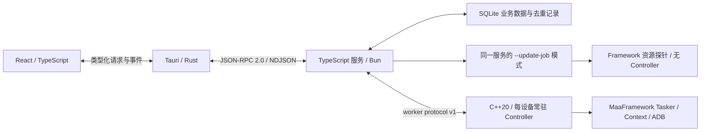

# TypeScript / C++ 运行时迁移交接

更新日期：2026-11-04。桌面、开发和发行统一使用固定 Bun 1.4.3 的 TypeScript 应用服务与 C++20 MaaFramework worker。Python 参考后端和 MaaCore 加载、数字回调、原生队列及回退链路已移除。用户无需安装 Python、Node 或 Bun。实际验证与平台限制以 [STATUS.md](STATUS.md) 为准，历史发行和实机报告不改写为本轮通过。

## 进程与职责



页面只经 contracts 的类型化 transport 调用服务。TypeScript 负责计划、策略、SQLite、预检、执行证据和应用／MaaFramework／资源三个独立更新通道。C++ 负责 Framework 动态加载、共享设备租约、Controller、Tasker／Context、超时和停止，不写业务数据库。NDJSON 使用 UTF-8；stdout 仅写协议，日志写 stderr，原生输出带 `protocolVersion: 1`。

每台设备只有一个 Framework 控制 worker。连接空闲与业务占用分开，任务表、工具、手动及 Debug 持有互斥会话，结束后保留空闲 Controller 与 OS 设备锁。预览复用连接，离线识别 reader 不建立 Controller。停止取消当前 Tasker，不能暂停恢复；任务完成不足以证明动作成功，提交后未知保留证据且不重放。

开发与产品均为真实 native 链路，没有自动 fallback。`--mode native` / `MAAVERGE_MODE=native` 仅为兼容；mock 模式明确拒绝。缺少 Framework 或资源时显示缺失，不生成演示设备、任务或进度。`pnpm dev` 启动真实服务；`pnpm dev:ui` 的普通浏览器缺少服务时明确报错。合成适配器只存在测试中。

stdio 通知 `runtime.event` 由 Tauri 映射为 `runtime-event`；宿主断连为 `runtime-disconnected`。

## 兼容编译、执行与历史

旧任务通过 `@maaverge/automation` 包根兼容编译为已登记能力。`execution.preflight` 检查整表所有启用任务，返回引擎、任务位置、参数路径和阻断原因；未知字段保持原样保存，未经迁移不得执行。启动重新检查当前完整快照；持久 requestId 查重优先，旧请求在升级、断线或资源移除后仍返回原记录。强制定时在倒计时、停止当前任务和准备设备前预检，真正启动再检。

官服与 B 服首轮流程和具体参数前提见[兼容矩阵](maa-compatibility.md)。药石和信用购物默认额度零，提交前事务预留额度，未知结果保守占用；不授权临期药、加急或无上限消耗。长战斗拆为有界只读等待，不重新开战。自定义基建文件只读、限额、防链接地保存文档与原字节 SHA-256，执行使用准入快照，保留原文件和官方协议语义。

新 `Run` 记录 `engine: maafw`、Framework 与资源版本，逐任务保存等待／执行／完成／失败／停止状态。旧记录缺少快照时不补造；历史 `coreVersion`、作业 `minimumCoreVersion` 保留原义，不能与 Framework 比较。`app.snapshot` 只携带摘要，`run.detail` 按需读取完整结果；任务结果元数据保留 1 MiB 内的边界。

结果必须 `completed` 且 `verified`；整轮基建逐房最终复读实际名单，不能用配置名单代替。目标掉落只累计明确读取的可见结算数量，标记 `scope: visible_rewards`，不代表所有掉落或完整库存。每步证据独立限制为 256 KiB 的结构化信息，并保存原结果 SHA-256 和截断标记；未知或部分完成也保留，不自动重放。

反馈 PNG 保存在 `run-artifacts/<runId>/<artifactId>.png`，每任务最多 3 张、每次执行最多 12 张、每张低于 3 MiB；数据库仅存 ID、标签与尺寸。结果后画面是事后核对图，不是原始结算识别图片，750 ms 后失效的迟到画面不归到下一任务。`run.artifact` 校验归属并按 ID 读取，禁止外部路径且不上传图片。

完整仓库／干员扫描、账号资料采集及三类作业执行尚未迁移，保存、导入、历史查看和导出继续使用已有记录。`recognition.get` 按设备／客户端／类型读取原始时间与来源，当前屏 OCR 只作局部观察，不能覆盖完整快照。无采集记录返回空时间与数组，不从旧事件编造库存。

## 预览、资源与更新

`device.frame` 返回 MaaFramework PNG、尺寸、采集时间、帧 ID、引擎和服务耗时；`device.click` 等输入必须有当前会话与新鲜帧。服务内存保留每设备最多 32 帧、2 秒的控制记录，输入／设备切换／会话结束后失效。输入按 requestId 缓存成功与失败，不自动重放未知动作。预览不落盘，执行页不会自动启动实时预览。

底部画面仍支持 5–120 Hz 目标刷新率，默认 60 Hz；图片使用 Blob URL，替换、隐藏或卸载即释放。请求和解码串行，不将 base64 留在 React 状态；实际帧率与往返耗时另行显示，目标值不等于已验证的持续性能。

`resources.item` 与 `resources.operator` 只读当前不可变资源，按客户端补全名称／头像和资源版本，不接受任意路径或联网地址。共享中文素材用于官服／B服；链接、越界、异常 PNG 和超限文件拒绝。资源中的技能说明和理论加成不作为本次实测产能。

游戏资源以固定官方 MAA 源码资源与模型底包为基础，叠加独立 MaaResource，生成完整不可变快照并用无 Controller 的 Framework 探针校验。资源检查、准备、空闲激活和回滚不依赖 MaaCore 安装；Framework SDK 独立安装。旧共目录资源只读复制和校验后接管，旧核心库和目录默认保留，不加载、不下载、不维护。官方资源归因与许可随快照保留，详见[资源安装](maacore-runtime.md)与[Framework 更新](framework-updates.md)。

## 数据交接与回退

当前产品继续使用 `<MAAVERGE_DATA_DIR>/native/maaverge.sqlite3`，沿用 migrations、objects、events 的结构及 JSON 字段，不把数据库移到数据根目录。旧 `<MAAVERGE_DATA_DIR>/mock` 目录保留，但产品不再读取、自动迁移或删除；其中的演示运行与更新状态不能当作真实设备记录。计划的未知任务参数、显式零预算、运行记录和持久化 `requestId` 必须保留。`objects` 按隐式 rowid 排序，备份不能用会重编号的 `VACUUM INTO`。

默认数据根现为程序目录下的 `config`（开发版为 checkout 下的 `config`），所以配置库为 `config/native/maaverge.sqlite3`。数据库集中保存 `settings/main`、任务表、设备连接和历史记录；缓存、服务日志与后续截图同属该数据根。WebView 内的最近任务表选择、预览帧率及未保存草稿仍是界面缓存，由 WebView 管理，不属于数据库备份。程序目录不可写时明确失败，不静默回退到用户目录；`MAAVERGE_DATA_DIR` 与 `--data-dir` 仍可显式指定其他根目录。

桌面“设置 → 数据与诊断 → 配置文件”可保存下次启动的数据根，选择器独立保存在程序目录的 `config-location.json`，避免把启动所需路径放进尚未定位的业务库。桌面宿主、调度和应用更新缓存统一使用本次启动固定的数据根；保存选择不热切换数据库，也不移动、覆盖或删除原根。显式启动参数和环境变量优先，设备锁仍保存在同机共享的标准目录。将现有配置搬到其他目录时，先完全退出并保全整个数据根及 WAL/SHM 文件；新根仍须取得相同的专用 SQLite 租约后才能打开业务库。

默认 TypeScript 后端在新库不存在时，从旧标准用户目录 `MAAVerge/native`（开发版为 `MAAVerge-dev/<checkout-hash>/native`）导入：同时持有源、目标数据根租约，只读序列化旧库，按下文的 fsync、完整性校验和改名流程发布新库，并复制相对 ID 引用的 `run-artifacts` 截图。失败不创建空业务库，重试会替换上次复制不完整的截图；已有目标库时不再导入，显式数据根覆盖不会自动读取旧用户数据。源数据库、旧备份和日志均保留；核心、资源及用户外部文件的绝对路径引用保持原值，因此迁移后不要删除仍被引用的旧组件目录。

| 锁           | 实现与生命周期                                                                                                                           |
| ------------ | ---------------------------------------------------------------------------------------------------------------------------------------- |
| 数据目录独占 | 应用服务各实例直接打开同一 `.runtime-lock.sqlite3`，设置 DELETE journal、`busy_timeout=0` 并保持 `BEGIN EXCLUSIVE`；持锁服务退出后才释放 |
| 设备控制权   | C++ worker 在共享设备锁目录持有文件锁；Windows 使用 LockFileEx，Unix 使用 flock，兼容旧版本的设备锁格式；Controller 销毁后释放           |

两个锁不共用文件，也不互相替代。不要删除或重建正在使用的锁文件。开发 worktree 的数据根各自隔离，设备锁目录由同机实例共享。旧版本尚无 SQLite 数据根租约，交接前必须先完全退出旧桌面和旧服务。

TypeScript 首次打开已有数据库时，先获得数据目录租约，再使用 `bun:sqlite.serialize()` 取得包含已提交 WAL 数据的完整镜像，写临时文件并 fsync。临时镜像通过独立可写连接转换为 DELETE journal，执行 `PRAGMA integrity_check`，关闭并再次 fsync 后，改名为同目录 `pre-typescript.sqlite3`；POSIX 还会同步父目录，再允许业务写入。这样生成的备份无需 WAL/SHM 文件，可由 macOS 系统 SQLite 直接只读打开。备份失败则拒绝启动；已有该备份时不覆盖。完整镜像保留隐式 rowid、事件 ID 和去重记录。开始接收请求后，遗留的 running 记录会标记为中断，不自动继续执行。

RPC、对象存取和原生任务发送使用数值 token 保留器：严格整数参数继续区分 `1` 与 `1.0` / `1e0`，禁用任务保存并重启后也保留原校验结果；未知扩展中的大整数按原始 JSON 数值文本传递。该实现使用固定 Bun 的 reviver source 与 `JSON.rawJSON`，不把额外标记写进业务对象。

需要比较或恢复时，先退出所有相关服务，保全当前数据库及其 WAL/SHM 文件，再把 `pre-typescript.sqlite3` 复制为一个新隔离数据根的 `native/maaverge.sqlite3`，通过 `MAAVERGE_DATA_DIR` 指向该根。先用隔离测试或只读数据库检查比较计划顺序、参数和记录；若启动服务核对，须预先关闭该副本的自动连接与自动更新。不直接覆盖仍在使用的数据，也不通过旧 mock 模式比较真实记录。预迁移备份不包含迁移后的新增记录，恢复它也不会回滚 MaaCore/资源目录或游戏状态。

开发和发行均只使用 TypeScript 应用服务。旧后端 selector 不再提供 Python 启动入口；服务缺失或失败时明确报错，不查找系统解释器，也不自动切换实现。旧数据库备份与兼容规则继续保留。

## 自包含发行与系统依赖

Bun `--compile` 将应用代码和 Bun/JavaScriptCore 放入同一可执行文件，仍由嵌入的 JS 引擎执行代码。它不是把所有 TypeScript 编译为不含引擎的静态机器码。Bun SQLite 在 Windows/Linux 随运行时链接，macOS 使用系统 SQLite；无需 `.node` 扩展或用户安装的 JavaScript 环境。

C++ worker 固定 C++20 与 nlohmann/json 3.12.0（单头文件及许可证保存在 `3rdparty/nlohmann-json`，CMake 校验 SHA-256，配置时不下载）。Windows 使用 `/MT`，Debug 为 `/MTd`；Linux 静态链接 libstdc++/libgcc，仍依赖系统 libc 与动态加载器；macOS 使用系统 libc++。MaaFramework 及其依赖在独立不可变 generation 中动态加载；worker 的静态 CRT 不替代 SDK 的平台依赖。

当前发行目标为 Windows x64、Linux x64、macOS arm64/x64。macOS 最低支持 15（Sequoia），Tauri 的 `minimumSystemVersion` 与 C++ worker / 原生探针的 `CMAKE_OSX_DEPLOYMENT_TARGET` 统一为 15.0；Bun 服务使用固定的预编译运行时，应用整体遵循 macOS 15 支持边界。Tauri/WebView、操作系统库、图形环境及原生 SDK 仍需满足平台要求。C++ worker 的 macOS 权限单独允许动态库校验例外与 DYLD 搜索路径，服务单独持有 JIT 权限；主应用不申请这些例外。正式签名、公证、安装及下载后动态库加载须在对应平台验收，预签名所用证书需提前导入构建机钥匙串。

```bash
pnpm install --frozen-lockfile
pnpm setup:bun
node tools/package-runtime.mjs
node tools/smoke-runtime.mjs
pnpm test:desktop-runtime
# 完整桌面构建还会生成前端并调用 Tauri。
pnpm build
```

`dist/runtime/maaverge-runtime` 包含应用服务和 C++ worker 两个可执行文件、`build-info.json` 和 `licenses/`。组件下载统一由 TypeScript 服务内置 HTTP 实现，保留断点续传、进度、代理和完整性校验；不再准备或打包 aria2，也不提供下载器选择或自定义可执行文件路径。已发布 v0.1.2 的包内 aria2 保持不变，当前源码构建布局见 [开发指南](development.md)。生产 CMake 使用 `BUILD_TESTING=OFF`；测试构建使用 Node 与独立原生锁探针驱动合成动态库、协议和锁互斥测试，开发与发行均不依赖 Python。

打包禁用自动加载 `.env` 与 `bunfig.toml`，启动时清理影响运行方式的 Node/Bun 环境选项。包内更新任务通过 `process.execPath` 重新启动同一服务的 `--update-job`，不依赖源码树或开发目录。最小探针检查空 PATH 下的 SQLite/WAL、保留 rowid 的备份、跨进程独占锁、子进程 NDJSON 与归档读取；包内 smoke 检查真实服务的空设备状态、Agent 提案、设置与计划保存、重启持久化、缺失设备拒绝和退出收尾，合成 Framework 可用时继续验证资源归档提取与无 Controller 探针。运行去重、空闲更新和回滚由注入合成适配器的服务测试覆盖。

`tools/smoke-desktop-runtime.mjs` / `pnpm test:desktop-runtime` 直接执行与桌面 `Runtime` 相同的 Rust transport → 包内原生服务，覆盖事件转发、环境清理、空设备、Agent 提案、设置和计划持久化及缺失设备拒绝；另以合成设备键启动 C++ 租约进程验证排他与释放。该 Rust 集成测试不启动实际窗口或 WebView，不能计作完整桌面交互验收。

安装包、桌面与干净容器 smoke 在启动前调用 `tools/test-support/seed-native.mjs`，由固定 Bun 执行独立的 `seed-native.ts`，通过 Store/parseSettings 在全新隔离根目录初始化 `native` 数据库，并关闭自动连接与自动更新。初始化工具拒绝已有业务数据库，不写入设备、计划或执行种子，不进入生产目录，也不为产品添加测试开关。`pnpm test:e2e` 使用测试目录内的 IPC 夹具；实际产品 transport 不导入这些替身，服务缺失时不回退。

## 许可、对应源码与重新构建

`tools/runtime-notices.mjs` 随发行目录收集应用 AGPL、[NOTICE](../NOTICE.md)及[社区作业来源与版权说明](copilot-attribution.md)、[Bun/JSC 声明](../services/backend/BUN-LICENSE.md)、[nlohmann/json 声明](../services/native/THIRD_PARTY_NOTICES.md)、Unicode、前后端 JavaScript 生产依赖，以及当前目标平台的 Rust 运行依赖和标准库许可。社区作业、说明与视频按各自权利人的授权使用，不自动适用应用 AGPL；声明保留在 `runtime/licenses/NOTICE.md` 与 `runtime/licenses/docs/copilot-attribution.md`。工作区内的 contracts 继续遍历其依赖；Cargo 使用锁文件与目标平台解析，排除构建依赖、开发依赖及过程宏。少数上游 crate 未随包提供许可正文，使用 [固定版本补充](../tools/licenses/README.md)并核对原始字节哈希；其他缺失正文会阻止打包。官方 MAA 资源与模型许可随资源快照保留，Framework SDK 许可随其独立 generation 保留。发布时应关联应用提交、锁文件、Bun tag、第三方来源与本地修改，保留可用于重新构建的源码和步骤。

Bun 自身为 MIT；其 JavaScriptCore/WebKit 包含 LGPL 组件，官方声明提供了修改 JSC 后重新链接 Bun 的方法。固定来源为 [Bun bun-v1.4.3](https://github.com/oven-sh/bun/tree/bun-v1.4.3) 与该版本使用的 [WebKit 0c06faadf65bf8e8c8ad3a5a8aca83e1e9ed653f](https://github.com/oven-sh/WebKit/tree/0c06faadf65bf8e8c8ad3a5a8aca83e1e9ed653f)。按固定 [bun-v1.4.3 的 CONTRIBUTING.md](https://github.com/oven-sh/bun/blob/bun-v1.4.3/CONTRIBUTING.md) 准备该版本要求的工具，Windows 另见其 [构建指南](https://bun.com/docs/project/building-windows)。在独立 Bun 源码 checkout 中执行上游步骤：

```bash
git clone --branch bun-v1.4.3 --depth 1 https://github.com/oven-sh/bun.git bun-source
cd bun-source
git clone https://github.com/oven-sh/WebKit vendor/WebKit
bun sync-webkit-source
# 在已同步的 WebKit 中应用修改；自定义提交同时更新上游 WEBKIT_VERSION。
bun run build:local
```

源码构建产物和具体工具版本以该 tag 的构建指南为准，不能把最新 Bun 的编译环境套到旧 tag。修改后的引擎可通过 Bun 1.4.3 已提供的 `--compile-executable-path` 重新嵌入本项目服务。以下为同平台 Unix shell 示例，先按常规脚本准备 worker、许可和前端，再替换服务；变量应指向同 OS/CPU 的自建 Bun 可执行文件：

```bash
pnpm -r build
node tools/package-runtime.mjs
maaverge_custom_bun='/absolute/path/to/custom/bun'
.tools/bun/bun build --compile \
  --compile-executable-path="$maaverge_custom_bun" \
  --no-compile-autoload-dotenv --no-compile-autoload-bunfig \
  services/backend/src/entry.ts \
  --outfile dist/runtime/maaverge-runtime/maaverge-runtime
```

Windows 使用 `.tools/bun/bun.exe` 和 `.exe` 输出名。记录自建 Bun/WebKit 的提交和修改；macOS 替换文件后须重新按 `RuntimeEntitlements.plist` 签名并验证。随后运行 `node tools/smoke-runtime.mjs` 与 `pnpm test:desktop-runtime`，再从 `apps/desktop` 执行 `pnpm exec tauri build -- --locked`。此处不要再次运行会重新打包官方 Bun 的 `pnpm build`。这些命令说明源码重建和替换入口，本轮没有执行完整 Bun/JSC 源码编译。

## 验证门槛与后续交接

产品服务的日志 RPC、导出目录、保留期与诊断覆盖范围见[日志导出与清理](logging.md)。

`.github/workflows/ci.yml` 的 Bun gate 在四个原生宿主分别编译并执行：Windows x64、Ubuntu x64、macOS arm64、macOS x64；全部成功后原生矩阵才构建 C++ 合成测试、运行 TypeScript 测试、Rust 检查和桌面打包。`node tools/probe-bun.mjs --all-targets` 可以交叉生成四种探针，但只有当前宿主会执行，结果中的 `executed: false` 不能计作平台验收。

此前运行时迁移在 Windows x64 开发主机、四平台宿主 CI 和 Ubuntu 22.04 干净容器记录过验证；历史结果不代表本次移除产品 mock 后已重新通过相同平台验收。`pnpm test:desktop-webview` 检查 Windows 实际 release 窗口；`pnpm test:clean-linux` 检查没有 Python/Node/Bun 的 Linux 容器后端。这些结果与干净系统安装、正式签名、公证和真实游戏行为分别记录。确切测试数量、包内 smoke、安装包及本次平台实况由 [STATUS.md](STATUS.md) 记录。

后续先完成最低系统、正式签名与安装、正式 Framework SDK 的加载和独立资源快照验证，再安排用户明确选择的设备行为测试。Python 参考的移除不替代这些验收；云模型 harness、视觉工具和持续托管仍按产品计划独立交付。
