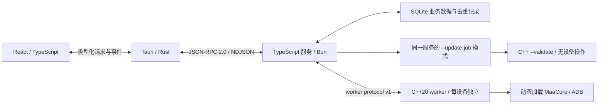

# TypeScript / C++ 运行时迁移交接

更新日期：2026-10-22。默认桌面链路已由 Python 改为 TypeScript 应用服务与 C++20 MaaCore worker。发行服务由固定 Bun 1.4.3 编译为可执行文件；用户无需安装 Python、Node 或 Bun。迁移实现与目标平台的实际验证是两项记录，最新结果以 [STATUS.md](STATUS.md) 为准。

## 进程与职责



| 范围 | 当前入口与约束 |
| --- | --- |
| 页面与 Tauri | 页面只使用 `packages/contracts` 的 transport；Rust 管理服务进程、窗口和系统集成 |
| 应用服务 | `services/backend/src/entry.ts`；计划、策略、SQLite、设备发现、执行监督、画面令牌与人工点击准入、三条独立更新通道 |
| Agent | `services/backend/src/agent.ts`；原生服务中保留本地确定性 mock 提案，需要审阅、保存后手动执行；真实云模型、持续托管及视觉 Agent 尚未接入 |
| 原生调用 | `services/native`；C++20 动态加载 MaaCore，复制回调、持有设备锁、处理异步 ID、调用超时和销毁 |
| 更新任务 | 包内服务 `--update-job`；选择性提取核心或合并固定提交的资源，调用 C++ `--validate`，不打开业务数据库 |
| 协议来源 | `packages/contracts/schemas`；JSON Schema 生成 TypeScript 类型和独立 Ajv 校验器，生成过程不调用 Python |
| Python 参考 | `services/runtime` 与 `tests/python`；开发回归和显式 debug 比较，不进入发行目录 |

JSON-RPC 使用 UTF-8 换行 JSON，stdout 仅承载协议，日志进入 stderr。原生输出带 `protocolVersion: 1`。每个设备只有一个控制者；原生调用结果不明时停止并要求核对，不自动重放。`AsstStop` 清空队列，不能作为暂停恢复。

开发桌面与发行服务均仅支持真实 `native` 链路，设备、执行、截图和更新没有产品 mock 分支。`--mode native` / `MAAVERGE_MODE=native` 保留兼容；旧 `--mode mock` / `MAAVERGE_MODE=mock` 明确报错。未安装核心时显示「未安装」，未连接设备时保持空列表或历史离线设备，不生成演示任务表、设备或执行进度。`pnpm dev` 启动真实桌面；`pnpm dev:ui` 只启动前端，普通浏览器没有桌面服务时明确报错，不补造后端结果。

stdio 通知方法保留 `runtime.event`；Tauri 宿主将其映射为合法事件名 `runtime-event`，页面订阅同名事件。宿主断连通知为 `runtime-disconnected`。Tauri 事件名不能包含点号，不能直接复用 JSON-RPC 方法名。

画面预览新增类型化 `device.frame({deviceId})` 与 `device.click({deviceId,frameId,x,y,requestId})`，由当前 TypeScript 服务和 C++ `frame` / `click` 命令承接。`ScreenFrame` 包含 PNG base64、尺寸、`capturedAt`、`frameId`、`canControl` 及服务取帧耗时；空闲时确认新截图，任务中只读取 MaaCore 最近缓存并禁用点击，时间字段不是运行中缓存的原始采集时间。预览 PNG 坐标直接交给同一 MaaCore 缩放代理，不换算为设备物理像素。

底部「画面」支持 5 / 10 / 15 / 30 / 60 / 90 / 120 Hz，默认目标 60 Hz，偏好保存在 `localStorage` 的 `maaverge:ui:preview-fps`；实际显示 FPS 与往返延迟单独呈现。前端请求与解码串行，并按 WebView 绘制节奏调度；图片使用 Blob URL，替换、取消、离线与卸载时释放，不在 React 状态保留 base64，性能统计每 250 毫秒更新。服务合并同设备的未完成取帧，保留完整协议校验，只解码固定 PNG 头检查尺寸，避免逐帧完整解码再编码的临时分配。隐藏、收起或切设备时停止后续刷新，避免高频请求排队。目标 60 Hz 不保证真实 60 FPS。预览接入时使用 mock 与合成核心验证；移除产品 mock 不增加真实模拟器持续帧率或点击效果的验收结论。

任务表执行页只展示按任务保存的结果截图，进入执行页、选择任务或跟随当前任务均不启动实时预览。需要查看连续画面时，显式打开底部「画面」入口；反馈截图仍由服务在收到任务结果后按需获取和保存。

服务仅在内存中维护每设备最近 32 帧、最长 2 秒的控制记录，核验设备、worker、`canControl` 与空闲状态后接受点击；点击按会话内 `requestId` 缓存成功与失败结果，不持久化去重，也不自动重放未知动作。连续预览 PNG 不落盘；点击事件只携带操作元数据。Python debug 参考尚未实现这两个新接口，选中参考后会明确报错，不自动切换后端。详细接口及限制见 [画面预览与人工点击](emulator-connection.md#画面预览与人工点击)。

执行快照新增可选 `Run.planName` 与 `Run.tasks`，持久保存本次启用的任务、顺序、等待/执行/完成/失败/停止/跳过状态和各自结果；旧执行记录缺少任务快照时不补造。`app.snapshot` 和执行事件只带基础执行摘要；使用类型化 `run.detail({id})` 读取单次执行的完整持久结果，避免 100 次历史结果重复挤占传输行大小。每次执行的任务元数据低于 1 MiB，写结果时预留状态和截图元数据空间，达到上限后仅通知一次并停止保存后续新结果，状态继续更新。重复类型按顺序索引与当前 native task ID 隔离，成功仍要求当前任务链成功、队列结束和异步调用空闲。停止或失败后，后续任务保持等待，表示未执行。运行和常见 ProcessTask 动作使用共享中文 formatter。

根据原版 v6.20.0 [回调协议](https://github.com/MaaAssistantArknights/MaaAssistantArknights/blob/v6.20.0/docs/zh-cn/protocol/callback-schema.md)及 `StageDropsTaskPlugin` / `InfrastAbstractTask`，`StageDrops.stats` 作为每个作战任务的累计材料，重复通知不累加；基建按设施与房间整合产物、方案指定干员及确认回调，指定名单本身不证明换班成功。最多保留每任务 200 种材料和 100 个基建房间。回调原始识别图片没有通过 C API 返回，服务在收到有效结果后从现有 `frame` 链路获取反馈画面；运行中读取核心最近缓存，可能已进入后续画面，不能视为结算原图。安全任务边界最多等待当前反馈画面 750 毫秒，随后使超时的截图请求失效；任务、执行或 worker 更换后的迟到响应丢弃，不挪给其他任务。

反馈 PNG 保存到当前数据根的 `run-artifacts/<runId>/<artifactId>.png`，每任务最多 3 张、每次执行最多 12 张，每张低于 3 MiB 且不超过 8192 边长/16777216 像素。SQLite、事件和快照只保存尺寸、标签与 ID，通过类型化 `run.artifact({runId,artifactId})` 显式读取 `{mimeType,data}`；核验执行归属，不接受路径，不上传图片。`capturedAt` 是服务取帧时间。取图失败保留实际核心结果并记录诊断；Python debug 参考没有执行产物接口。

仓库/干员使用 `recognition.get({deviceId,kind,clientType?})` 按需读取本机快照，`kind` 为 `depot` / `operators`。返回设备、客户端、采集时间、来源执行 ID 和物品/干员数组；无成功采集时两个时间/执行字段为空、数组为空，不从旧事件推断库存。服务仅在有效的 `DepotInfo` / `OperBoxInfo` 最终回调、匹配任务成功且核心安全空闲后事务保存结果与同步时间；单次及 UserDataUpdate 均支持。按设备/客户端/类型隔离，确认账号或客户端切换后清除此设备的快照，失败不覆盖旧成功数据。物品最多 10000 项、干员最多 2000 项，保存的结果数组限制为 2 MiB；查询时从启用资源补全物品名称，响应限制为 3 MiB，仍低于桌面 NDJSON 上限。`own`、精英化、等级、潜能和星级保持核心值，潜能/星级从 1 开始；负数保留未识别语义。

`resources.item({itemId,clientType?})` 只读取当前启用不可变 MaaResource 中的物品目录和 PNG，返回名称、资源版本、MIME 和 base64，缺失时名称/图像可为空。不接受文件路径，不联网下载；外服名称只读目标客户端索引，图片可回退共用模板，B服复用官服。固定目录读取拒绝链接、越界及超限文件，PNG 校验后最多 512 KiB；前端通过类型化 RPC 显示仓库与执行材料图，按资源版本缓存，缺图显示通用图标。Python debug 参考尚无这两个接口，明确报错而不切换后端。

`resources.operator({name,clientType?})` 从当前启用的不可变 MaaResource `battle_data.json` 干员目录精确匹配姓名，返回 `{name,id,rarity,mimeType,data,resourceVersion}`；星级从 1 开始，只接受 1–6。优先使用当前客户端名称，也接受目录中唯一对应的其他语言姓名；当前客户端缺少名称的条目不用于补全。同名多形态不猜头像，若所有候选星级相同仍返回该星级，冲突时星级为空。头像只读取固定 `template/avatar/<id>.png`，可使用外服覆盖目录，复用材料资源的有界读取、链接拒绝与 PNG 校验；缺失保留姓名，不联网获取。

基建房间新增可选 `staffingStatus`：`planned` 表示收到方案指定名单，`confirmed` 表示收到核心换班确认，`unavailable` 表示房间保持原样、未配置或编组不可用。产物等后续反馈不覆盖此证据，历史记录缺少字段时不推断确认。确认回调没有独立返回最终名单；普通自动换班也可能不提供干员姓名，不能把方案名单或任务完成当作重新识别到的最终进驻人员。资源中的技能说明和理论加成不能证明本次设施实际生效倍率，暂不展示为实测产能。

高频预览的运行状态查询使用 `objects` 上仅覆盖运行中记录的 `active_run_device` 索引；表格式、业务值、隐式 rowid 和请求去重数据保持兼容，首次接管备份在创建索引前完成。服务退出时先启动已有 worker 的有界关闭，再等待请求收尾，避免挂起的取帧请求让设备锁滞留在退出后的原生进程中。

核心精简提取的 `e6e8493` 和接入更新的 `103bc99` 已进入本次迁移基线，规则与测试已迁至 TypeScript；不需要另行重复应用。这部分只减少落盘范围，不减少官方完整包的下载流量。提取白名单和历史 Windows 数据见 [maacore-runtime.md](maacore-runtime.md)。

Windows 运行中模拟器的动态多开枚举、监听归属、自动增强截图和独立实例清单由 TypeScript 服务实现。`Settings.capture.autoDetect` 与 `DeviceConnectionProfile.autoDetected` 仅用于业务配置和界面，调用 C++ worker 前剥离；雷电截图 PID 在每次连接时核实，不写业务设置。Python debug 参考没有这些新能力，不能用参考后端替代或验收该路径。完整规则见 [连接设置](connection-settings.md) 和 [多开说明](multi-instance.md)。

## 分阶段取消 Python 的落点

1. 固定协议：保留现有 JSON-RPC 方法和事件，改由独立 JSON Schema 生成类型与校验，先让语言切换不影响页面。
2. 分离原生调用：C++20 worker 接管 MaaCore 加载、设备锁、回调及超时，应用服务只监督进程和维护业务队列。
3. 迁移业务：TypeScript 接管配置默认值、未知任务参数保留、预算校验、运行去重、ADB 发现、安装更新和 mock 提案。
4. 切换启动和打包：debug 默认固定 Bun，release 仅运行包内服务；更新辅助任务也使用同一自包含可执行文件。
5. 保留参考比较：Python 测试与显式 debug selector 继续使用，直到真实核心及各目标平台的发行验收完成。删除 Python 参考与测试是后续独立变更。

前四项已经实现；第五项用于继续验证兼容性。真实模型、定时调度、库存与专用识别结果等产品缺口没有因语言迁移而自动完成。普通测试不连接游戏、不使用真实账号或付费模型。

## 数据交接与回退

当前产品继续使用 `<MAAVERGE_DATA_DIR>/native/maaverge.sqlite3`，沿用 migrations、objects、events 的结构及 JSON 字段，不把数据库移到数据根目录。旧 `<MAAVERGE_DATA_DIR>/mock` 目录保留，但产品不再读取、自动迁移或删除；其中的演示运行与更新状态不能当作真实设备记录。计划的未知任务参数、显式零预算、运行记录和持久化 `requestId` 必须保留。`objects` 按隐式 rowid 排序，备份不能用会重编号的 `VACUUM INTO`。

默认数据根现为程序目录下的 `config`（开发版为 checkout 下的 `config`），所以配置库为 `config/native/maaverge.sqlite3`。数据库集中保存 `settings/main`、任务表、设备连接和历史记录；缓存、服务日志与后续截图同属该数据根。WebView 内的最近任务表选择、预览帧率及未保存草稿仍是界面缓存，由 WebView 管理，不属于数据库备份。程序目录不可写时明确失败，不静默回退到用户目录；`MAAVERGE_DATA_DIR` 与 `--data-dir` 仍可显式指定其他根目录。

默认 TypeScript 后端在新库不存在时，从旧标准用户目录 `MAAVerge/native`（开发版为 `MAAVerge-dev/<checkout-hash>/native`）导入：同时持有源、目标数据根租约，只读序列化旧库，按下文的 fsync、完整性校验和改名流程发布新库，并复制相对 ID 引用的 `run-artifacts` 截图。失败不创建空业务库，重试会替换上次复制不完整的截图；已有目标库时不再导入，显式数据根覆盖不会自动读取旧用户数据。源数据库、旧备份和日志均保留；核心、资源及用户外部文件的绝对路径引用保持原值，因此迁移后不要删除仍被引用的旧组件目录。Python debug 参考不执行这次自动导入，检测到旧开发库时提示先用默认后端迁移。

| 锁 | 实现与生命周期 |
| --- | --- |
| 数据目录独占 | TypeScript 与当前 Python 参考都直接打开同一 `.runtime-lock.sqlite3`，设置 DELETE journal、`busy_timeout=0` 并保持 `BEGIN EXCLUSIVE`；持锁服务退出后才释放 |
| 设备控制权 | C++ worker 在共享设备锁目录持有文件锁；Windows 使用 LockFileEx，Unix 使用 flock，与 Python filelock 兼容；销毁核心后释放 |

两个锁不共用文件，也不互相替代。不要删除或重建正在使用的锁文件。开发 worktree 的数据根各自隔离，设备锁目录由同机实例共享。旧版本尚无 SQLite 数据根租约，交接前必须先完全退出旧桌面和旧服务。

TypeScript 首次打开已有数据库时，先获得数据目录租约，再使用 `bun:sqlite.serialize()` 取得包含已提交 WAL 数据的完整镜像，写临时文件并 fsync。临时镜像通过独立可写连接转换为 DELETE journal，执行 `PRAGMA integrity_check`，关闭并再次 fsync 后，改名为同目录 `pre-typescript.sqlite3`；POSIX 还会同步父目录，再允许业务写入。这样生成的备份无需 WAL/SHM 文件，可由 macOS 系统 SQLite 直接只读打开。备份失败则拒绝启动；已有该备份时不覆盖。完整镜像保留隐式 rowid、事件 ID 和去重记录。开始接收请求后，遗留的 running 记录会标记为中断，不自动继续执行。

RPC、对象存取和原生任务发送使用数值 token 保留器：严格整数参数继续区分 `1` 与 `1.0` / `1e0`，禁用任务保存并重启后也保留原校验结果；未知扩展中的大整数按原始 JSON 数值文本传递。该实现使用固定 Bun 的 reviver source 与 `JSON.rawJSON`，不把额外标记写进业务对象。

需要比较或恢复时，先退出所有相关服务，保全当前数据库及其 WAL/SHM 文件，再把 `pre-typescript.sqlite3` 复制为一个新隔离数据根的 `native/maaverge.sqlite3`，通过 `MAAVERGE_DATA_DIR` 指向该根。先用隔离测试或只读数据库检查比较计划顺序、参数和记录；若启动服务核对，须预先关闭该副本的自动连接与自动更新。不直接覆盖仍在使用的数据，也不通过旧 mock 模式比较真实记录。预迁移备份不包含迁移后的新增记录，恢复它也不会回滚 MaaCore/资源目录或游戏状态。

Python 参考只在 debug 桌面构建中显式启用：

```powershell
$env:MAAVERGE_BACKEND = 'python'
powershell -ExecutionPolicy Bypass -File tools/pnpm.ps1 dev
# 下次切回默认服务前，在同一终端移除此 selector。
Remove-Item Env:MAAVERGE_BACKEND
```

```bash
MAAVERGE_BACKEND=python bash tools/pnpm.sh dev
```

selector 选择旧应用服务及其原生适配路径，用于比较；桌面比较也使用 native 数据目录，不恢复产品 mock。Python 参考测试内部仍保留旧 mock fixture，不能把它作为普通产品启动方式。release 忽略该 selector；包内服务缺失或启动失败会报错，不查找系统解释器，不自动降级到 Python。

## 自包含发行与系统依赖

Bun `--compile` 将应用代码和 Bun/JavaScriptCore 放入同一可执行文件，仍由嵌入的 JS 引擎执行代码。它不是把所有 TypeScript 编译为不含引擎的静态机器码。Bun SQLite 在 Windows/Linux 随运行时链接，macOS 使用系统 SQLite；无需 `.node` 扩展或用户安装的 JavaScript 环境。

C++ worker 固定 C++20 与 nlohmann/json 3.12.0（单头文件及许可证保存在 `3rdparty/nlohmann-json`，CMake 校验 SHA-256，配置时不下载）。Windows 使用 `/MT`，Debug 为 `/MTd`；Linux 静态链接 libstdc++/libgcc，仍依赖系统 libc 与动态加载器；macOS 使用系统 libc++。MaaCore、控制单元和其依赖在不可变 generation 中动态加载，不能把 worker 的静态 CRT 当作 MaaCore 没有依赖。

当前发行目标为 Windows x64、Linux x64、macOS arm64/x64。macOS 最低目标为 13.5，受 Bun 约束；Tauri/WebView、操作系统库、图形环境及原生 SDK 仍需满足平台要求。C++ worker 的 macOS 权限单独允许动态库校验例外与 DYLD 搜索路径，服务单独持有 JIT 权限；主应用不申请这些例外。正式签名、公证、安装及下载后动态库加载须在对应平台验收，预签名所用证书需提前导入构建机钥匙串。

```bash
pnpm install --frozen-lockfile
pnpm setup:bun
node tools/package-runtime.mjs
node tools/smoke-runtime.mjs
pnpm test:desktop-runtime
# 完整桌面构建还会生成前端并调用 Tauri。
pnpm build
```

`dist/runtime/maaverge-runtime` 包含应用服务、C++ worker、`aria2c[.exe]` 三个可执行文件、`build-info.json` 和 `licenses/`。aria2 固定版本并随包携带许可、对应源码和构建信息；下载引擎由 TypeScript 服务持有，不并入 MaaCore worker。新配置默认使用包内 aria2，空路径不查找 PATH；既有内置 HTTP 下载器选择保留。开发通过 `pnpm setup:aria2` 准备，详见 [开发指南](development.md)。生产 CMake 使用 `BUILD_TESTING=OFF`，不需要 Python。测试构建使用 Python 3.12/filelock 驱动合成动态库与锁互斥测试；这不构成发行依赖。

打包禁用自动加载 `.env` 与 `bunfig.toml`，启动时清理影响运行方式的 Node/Bun 环境选项。包内更新任务通过 `process.execPath` 重新启动同一服务的 `--update-job`，不依赖源码树或开发目录。最小探针检查空 PATH 下的 SQLite/WAL、保留 rowid 的备份、跨进程独占锁、子进程 NDJSON 与归档读取；包内 smoke 检查真实服务的空设备状态、Agent 提案、设置与计划保存、重启持久化、缺失设备拒绝和退出收尾，合成核心可用时继续验证 `--update-job` 的选择性归档提取与 C++ 校验。运行去重、空闲更新和回滚由注入合成适配器的服务测试覆盖。

`tools/smoke-desktop-runtime.mjs` / `pnpm test:desktop-runtime` 直接执行与桌面 `Runtime` 相同的 Rust transport → 包内原生服务，覆盖事件转发、环境清理、空设备、Agent 提案、设置和计划持久化及缺失设备拒绝；另以合成设备键启动 C++ 租约进程验证排他与释放。该 Rust 集成测试不启动实际窗口或 WebView，不能计作完整桌面交互验收。

安装包、桌面与干净容器 smoke 在启动前调用 `tools/test-support/seed-native.mjs`，由固定 Bun 执行独立的 `seed-native.ts`，通过 Store/parseSettings 在全新隔离根目录初始化 `native` 数据库，并关闭自动连接与自动更新。初始化工具拒绝已有业务数据库，不写入设备、计划或执行种子，不进入生产目录，也不为产品添加测试开关。`pnpm test:e2e` 使用测试目录内的 IPC 夹具；实际产品 transport 不导入这些替身，服务缺失时不回退。

## 许可、对应源码与重新构建

`tools/runtime-notices.mjs` 随发行目录收集应用 AGPL、[NOTICE](../NOTICE.md)及[社区作业来源与版权说明](copilot-attribution.md)、[Bun/JSC 声明](../services/backend/BUN-LICENSE.md)、[nlohmann/json 声明](../services/native/THIRD_PARTY_NOTICES.md)、Unicode、前后端 JavaScript 生产依赖，以及当前目标平台的 Rust 运行依赖和标准库许可。社区作业、说明与视频按各自权利人的授权使用，不自动适用应用 AGPL；声明保留在 `runtime/licenses/NOTICE.md` 与 `runtime/licenses/docs/copilot-attribution.md`。工作区内的 contracts 继续遍历其依赖；Cargo 使用锁文件与目标平台解析，排除构建依赖、开发依赖及过程宏。少数上游 crate 未随包提供许可正文，使用 [固定版本补充](../tools/licenses/README.md)并核对原始字节哈希；其他缺失正文会阻止打包。MaaCore 归档中的许可另随核心 generation 保留。发布时应关联应用提交、锁文件、Bun tag、第三方来源与本地修改，保留可用于重新构建的源码和步骤。

Bun 自身为 MIT；其 JavaScriptCore/WebKit 包含 LGPL 组件，官方声明提供了修改 JSC 后重新链接 Bun 的方法。固定来源为 [Bun bun-v1.4.3](https://github.com/oven-sh/bun/tree/bun-v1.4.3) 与该版本使用的 [WebKit 0c06faadf65bf8e8c8ad3a5a8aca83e1e9ed653f](https://github.com/oven-sh/WebKit/tree/0c06faadf65bf8e8c8ad3a5a8aca83e1e9ed653f)。按固定 [bun-v1.4.3 的 CONTRIBUTING.md](https://github.com/oven-sh/bun/blob/bun-v1.4.3/CONTRIBUTING.md) 准备该版本要求的工具，Windows 另见其 [构建指南](https://bun.com/docs/project/building-windows)。在独立 Bun 源码 checkout 中执行上游步骤：

```bash
git clone --branch bun-v1.4.3 --depth 1 https://github.com/oven-sh/bun.git bun-source
cd bun-source
git clone https://github.com/oven-sh/WebKit vendor/WebKit
bun sync-webkit-source
# 在已同步的 WebKit 中应用修改；自定义提交同时更新上游 WEBKIT_VERSION。
bun run build:local
```

源码构建产物和具体工具版本以该 tag 的构建指南为准，不能把最新 Bun 的编译环境套到旧 tag。修改后的引擎可通过 Bun 1.4.3 已提供的 `--compile-executable-path` 重新嵌入本项目服务。以下为同平台 Unix shell 示例，先按常规脚本准备 worker、许可和前端，再替换服务；变量应指向同 OS/CPU 的自建 Bun 可执行文件：

```bash
pnpm -r build
node tools/package-runtime.mjs
maaverge_custom_bun='/absolute/path/to/custom/bun'
.tools/bun/bun build --compile \
  --compile-executable-path="$maaverge_custom_bun" \
  --no-compile-autoload-dotenv --no-compile-autoload-bunfig \
  services/backend/src/entry.ts \
  --outfile dist/runtime/maaverge-runtime/maaverge-runtime
```

Windows 使用 `.tools/bun/bun.exe` 和 `.exe` 输出名。记录自建 Bun/WebKit 的提交和修改；macOS 替换文件后须重新按 `RuntimeEntitlements.plist` 签名并验证。随后运行 `node tools/smoke-runtime.mjs` 与 `pnpm test:desktop-runtime`，再从 `apps/desktop` 执行 `pnpm exec tauri build -- --locked`。此处不要再次运行会重新打包官方 Bun 的 `pnpm build`。这些命令说明源码重建和替换入口，本轮没有执行完整 Bun/JSC 源码编译。

## 验证门槛与后续交接

产品服务的日志 RPC、导出目录、保留期与诊断覆盖范围见[日志导出与清理](logging.md)。Python 参考仅兼容 `logRetentionDays` 设置的存储格式，不提供日志维护功能。

`.github/workflows/ci.yml` 的 Bun gate 在四个原生宿主分别编译并执行：Windows x64、Ubuntu x64、macOS arm64、macOS x64；全部成功后原生矩阵才构建 C++ 合成测试、运行 TypeScript 测试、Rust 检查和桌面打包。`node tools/probe-bun.mjs --all-targets` 可以交叉生成四种探针，但只有当前宿主会执行，结果中的 `executed: false` 不能计作平台验收。

此前运行时迁移在 Windows x64 开发主机、四平台宿主 CI 和 Ubuntu 22.04 干净容器记录过验证；历史结果不代表本次移除产品 mock 后已重新通过相同平台验收。`pnpm test:desktop-webview` 检查 Windows 实际 release 窗口；`pnpm test:clean-linux` 检查没有 Python/Node/Bun 的 Linux 容器后端。这些结果与干净系统安装、正式签名、公证和真实游戏行为分别记录。确切测试数量、包内 smoke、安装包及本次平台实况由 [STATUS.md](STATUS.md) 记录。

后续先完成最低系统、正式签名与安装、真实核心的加载和资源组合验证，再安排用户明确选择的设备行为测试。只有这些门槛完成，才评估删除 Python 参考；云模型 harness、视觉工具和持续托管仍按产品计划独立交付。
