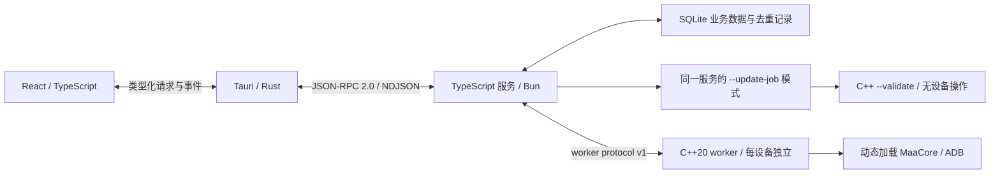

# TypeScript / C++ 运行时迁移交接

更新日期：2026-10-22。默认桌面链路已由 Python 改为 TypeScript 应用服务与 C++20 MaaCore worker。发行服务由固定 Bun 1.4.3 编译为可执行文件；用户无需安装 Python、Node 或 Bun。迁移实现与目标平台的实际验证是两项记录，最新结果以 [STATUS.md](STATUS.md) 为准。

## 进程与职责



| 范围 | 当前入口与约束 |
| --- | --- |
| 页面与 Tauri | 页面只使用 `packages/contracts` 的 transport；Rust 管理服务进程、窗口和系统集成 |
| 应用服务 | `services/backend/src/entry.ts`；计划、策略、SQLite、设备发现、执行监督和三条独立更新通道 |
| Agent | `services/backend/src/agent.ts`；仅 mock 的确定性规则提案，需要审阅、保存后手动执行；真实云模型、持续托管及视觉 Agent 尚未接入 |
| 原生调用 | `services/native`；C++20 动态加载 MaaCore，复制回调、持有设备锁、处理异步 ID、调用超时和销毁 |
| 更新任务 | 包内服务 `--update-job`；选择性提取核心或合并固定提交的资源，调用 C++ `--validate`，不打开业务数据库 |
| 协议来源 | `packages/contracts/schemas`；JSON Schema 生成 TypeScript 类型和独立 Ajv 校验器，生成过程不调用 Python |
| Python 参考 | `services/runtime` 与 `tests/python`；开发回归和显式 debug 比较，不进入发行目录 |

JSON-RPC 使用 UTF-8 换行 JSON，stdout 仅承载协议，日志进入 stderr。原生输出带 `protocolVersion: 1`。每个设备只有一个控制者；原生调用结果不明时停止并要求核对，不自动重放。`AsstStop` 清空队列，不能作为暂停恢复。

stdio 通知方法保留 `runtime.event`；Tauri 宿主将其映射为合法事件名 `runtime-event`，页面订阅同名事件。宿主断连通知为 `runtime-disconnected`。Tauri 事件名不能包含点号，不能直接复用 JSON-RPC 方法名。

核心精简提取的 `e6e8493` 和接入更新的 `103bc99` 已进入本次迁移基线，规则与测试已迁至 TypeScript；不需要另行重复应用。这部分只减少落盘范围，不减少官方完整包的下载流量。提取白名单和历史 Windows 数据见 [maacore-runtime.md](maacore-runtime.md)。

## 分阶段取消 Python 的落点

1. 固定协议：保留现有 JSON-RPC 方法和事件，改由独立 JSON Schema 生成类型与校验，先让语言切换不影响页面。
2. 分离原生调用：C++20 worker 接管 MaaCore 加载、设备锁、回调及超时，应用服务只监督进程和维护业务队列。
3. 迁移业务：TypeScript 接管配置默认值、未知任务参数保留、预算校验、运行去重、ADB 发现、安装更新和 mock 提案。
4. 切换启动和打包：debug 默认固定 Bun，release 仅运行包内服务；更新辅助任务也使用同一自包含可执行文件。
5. 保留参考比较：Python 测试与显式 debug selector 继续使用，直到真实核心及各目标平台的发行验收完成。删除 Python 参考与测试是后续独立变更。

前四项已经实现；第五项用于继续验证兼容性。真实模型、定时调度、库存与专用识别结果等产品缺口没有因语言迁移而自动完成。普通测试不连接游戏、不使用真实账号或付费模型。

## 数据交接与回退

数据仍位于 `<MAAVERGE_DATA_DIR>/<mock|native>`，业务数据库仍为 `maaverge.sqlite3`，沿用 migrations、objects、events 的结构及 JSON 字段。计划的未知任务参数、显式零预算、运行记录和持久化 `requestId` 必须保留。`objects` 按隐式 rowid 排序，备份不能用会重编号的 `VACUUM INTO`。

| 锁 | 实现与生命周期 |
| --- | --- |
| 数据目录独占 | TypeScript 与当前 Python 参考都直接打开同一 `.runtime-lock.sqlite3`，设置 DELETE journal、`busy_timeout=0` 并保持 `BEGIN EXCLUSIVE`；持锁服务退出后才释放 |
| 设备控制权 | C++ worker 在共享设备锁目录持有文件锁；Windows 使用 LockFileEx，Unix 使用 flock，与 Python filelock 兼容；销毁核心后释放 |

两个锁不共用文件，也不互相替代。不要删除或重建正在使用的锁文件。开发 worktree 的数据根各自隔离，设备锁目录由同机实例共享。旧版本尚无 SQLite 数据根租约，交接前必须先完全退出旧桌面和旧服务。

TypeScript 首次打开已有数据库时，先获得数据目录租约，再使用 `bun:sqlite.serialize()` 取得包含已提交 WAL 数据的完整镜像，写临时文件并 fsync。临时镜像通过独立可写连接转换为 DELETE journal，执行 `PRAGMA integrity_check`，关闭并再次 fsync 后，改名为同目录 `pre-typescript.sqlite3`；POSIX 还会同步父目录，再允许业务写入。这样生成的备份无需 WAL/SHM 文件，可由 macOS 系统 SQLite 直接只读打开。备份失败则拒绝启动；已有该备份时不覆盖。完整镜像保留隐式 rowid、事件 ID 和去重记录。开始接收请求后，遗留的 running 记录会标记为中断，不自动继续执行。

RPC、对象存取和原生任务发送使用数值 token 保留器：严格整数参数继续区分 `1` 与 `1.0` / `1e0`，禁用任务保存并重启后也保留原校验结果；未知扩展中的大整数按原始 JSON 数值文本传递。该实现使用固定 Bun 的 reviver source 与 `JSON.rawJSON`，不把额外标记写进业务对象。

需要比较或恢复时，先退出所有相关服务，保全当前数据库及其 WAL/SHM 文件，再把 `pre-typescript.sqlite3` 复制为一个新隔离数据根对应模式目录中的 `maaverge.sqlite3`，通过 `MAAVERGE_DATA_DIR` 指向该根。先以 mock 比较计划顺序、参数和记录，不直接覆盖仍在使用的数据。预迁移备份不包含迁移后的新增记录，恢复它也不会回滚 MaaCore/资源目录或游戏状态。

Python 参考只在 debug 桌面构建中显式启用：

```powershell
$env:MAAVERGE_BACKEND = 'python'
powershell -ExecutionPolicy Bypass -File tools/pnpm.ps1 dev
# 下次切回默认服务前，在同一终端移除此 selector。
Remove-Item Env:MAAVERGE_BACKEND
```

```bash
MAAVERGE_BACKEND=python bash tools/pnpm.sh dev
```

selector 选择旧应用服务及其原生适配路径，用于比较。release 忽略该 selector；包内服务缺失或启动失败会报错，不查找系统解释器，不自动降级到 Python。

## 自包含发行与系统依赖

Bun `--compile` 将应用代码和 Bun/JavaScriptCore 放入同一可执行文件，仍由嵌入的 JS 引擎执行代码。它不是把所有 TypeScript 编译为不含引擎的静态机器码。Bun SQLite 在 Windows/Linux 随运行时链接，macOS 使用系统 SQLite；无需 `.node` 扩展或用户安装的 JavaScript 环境。

C++ worker 固定 C++20 与 nlohmann/json 3.12.0（CMake 固定 SHA-256）。Windows 使用 `/MT`，Debug 为 `/MTd`；Linux 静态链接 libstdc++/libgcc，仍依赖系统 libc 与动态加载器；macOS 使用系统 libc++。MaaCore、控制单元和其依赖在不可变 generation 中动态加载，不能把 worker 的静态 CRT 当作 MaaCore 没有依赖。

当前发行目标为 Windows x64、Linux x64、macOS arm64/x64。macOS 最低目标为 13.5，受 Bun 约束；Tauri/WebView、操作系统库、图形环境及原生 SDK 仍需满足平台要求。C++ worker 的 macOS 权限单独允许动态库校验例外与 DYLD 搜索路径，服务单独持有 JIT 权限；主应用不申请这些例外。正式签名、公证、安装及下载后动态库加载须在对应平台验收，预签名所用证书需提前导入构建机钥匙串。

```bash
pnpm install --frozen-lockfile
pnpm setup:bun
node tools/package-runtime.mjs
node tools/smoke-runtime.mjs
pnpm test:desktop-runtime
# 完整桌面构建还会生成前端并调用 Tauri。
pnpm build
```

`dist/runtime/maaverge-runtime` 包含两个可执行文件、`build-info.json` 和 `licenses/`。生产 CMake 使用 `BUILD_TESTING=OFF`，不需要 Python。测试构建使用 Python 3.12/filelock 驱动合成动态库与锁互斥测试；这不构成发行依赖。

打包禁用自动加载 `.env` 与 `bunfig.toml`，启动时清理影响运行方式的 Node/Bun 环境选项。包内更新任务通过 `process.execPath` 重新启动同一服务的 `--update-job`，不依赖源码树或开发目录。最小探针检查空 PATH 下的 SQLite/WAL、保留 rowid 的备份、跨进程独占锁、子进程 NDJSON 与归档读取；包内 smoke 还检查设备租约、持久化、运行去重、空闲更新和退出收尾。

`tools/smoke-desktop-runtime.mjs` / `pnpm test:desktop-runtime` 还直接执行桌面 `Runtime` 相同的 Rust transport → 包内服务 → C++ mock 租约进程，覆盖事件转发、环境清理、设备锁排他与释放以及重启后的设置和去重记录。该 Rust 集成测试不启动实际窗口或 WebView，不能计作完整桌面交互验收。

## 许可、对应源码与重新构建

`tools/runtime-notices.mjs` 随发行目录收集应用 AGPL、[Bun/JSC 声明](../services/backend/BUN-LICENSE.md)、[nlohmann/json 声明](../services/native/THIRD_PARTY_NOTICES.md)、Unicode 及归档依赖的许可。MaaCore 归档中的许可另随核心 generation 保留。发布时应关联应用提交、锁文件、Bun tag、第三方来源与本地修改，保留可用于重新构建的源码和步骤。

Bun 自身为 MIT；其 JavaScriptCore/WebKit 包含 LGPL 组件，官方声明提供了修改 JSC 后重新链接 Bun 的方法。按固定 [bun-v1.4.3 的 CONTRIBUTING.md](https://github.com/oven-sh/bun/blob/bun-v1.4.3/CONTRIBUTING.md) 准备该版本要求的工具，Windows 另见其 [构建指南](https://bun.com/docs/project/building-windows)。在独立 Bun 源码 checkout 中执行上游步骤：

```bash
git clone --branch bun-v1.4.3 --depth 1 https://github.com/oven-sh/bun.git bun-source
cd bun-source
git clone https://github.com/oven-sh/WebKit vendor/WebKit
bun sync-webkit-source
# 在已同步的 WebKit 中应用修改；自定义提交同时更新上游 WEBKIT_VERSION。
bun run build:local
```

源码构建产物和具体工具版本以该 tag 的构建指南为准，不能把最新 Bun 的编译环境套到旧 tag。修改后的引擎可通过 Bun 1.4.3 已提供的 `--compile-executable-path` 重新嵌入本项目服务。以下为同平台 Unix shell 示例，先按常规脚本准备 worker、许可和前端，再替换服务；变量应指向同 OS/CPU 的自建 Bun 可执行文件：

```bash
pnpm -r build
node tools/package-runtime.mjs
maaverge_custom_bun='/absolute/path/to/custom/bun'
.tools/bun/bun build --compile \
  --compile-executable-path="$maaverge_custom_bun" \
  --no-compile-autoload-dotenv --no-compile-autoload-bunfig \
  services/backend/src/entry.ts \
  --outfile dist/runtime/maaverge-runtime/maaverge-runtime
```

Windows 使用 `.tools/bun/bun.exe` 和 `.exe` 输出名。记录自建 Bun/WebKit 的提交和修改；macOS 替换文件后须重新按 `RuntimeEntitlements.plist` 签名并验证。随后运行 `node tools/smoke-runtime.mjs` 与 `pnpm test:desktop-runtime`，再从 `apps/desktop` 执行 `pnpm exec tauri build -- --locked`。此处不要再次运行会重新打包官方 Bun 的 `pnpm build`。这些命令说明源码重建和替换入口，本轮没有执行完整 Bun/JSC 源码编译。

## 验证门槛与后续交接

`.github/workflows/ci.yml` 的 Bun gate 在四个原生宿主分别编译并执行：Windows x64、Ubuntu x64、macOS arm64、macOS x64；全部成功后原生矩阵才构建 C++ 合成测试、运行 TypeScript 测试、Rust 检查和桌面打包。`node tools/probe-bun.mjs --all-targets` 可以交叉生成四种探针，但只有当前宿主会执行，结果中的 `executed: false` 不能计作平台验收。

本轮工作主机是 Windows x64；Linux/macOS 的配置、源码和交叉编译结果不代表对应平台已执行或游戏行为已验证。确切测试数量、包内 smoke、安装包及平台实况由 [STATUS.md](STATUS.md) 记录。

后续先完成 Linux/macOS 宿主 gate、签名与安装、真实核心的加载和资源组合验证，再安排用户明确选择的设备行为测试。只有这些门槛完成，才评估删除 Python 参考；云模型 harness、视觉工具和持续托管仍按产品计划独立交付。
